<!-- SPDX-License-Identifier: Apache-2.0 OR MIT -->

<p align="right"><a href="README.tr.md">Türkçe</a> · <b>English</b></p>

<p align="center">
  
</p>

<h1 align="center">Kor</h1>

<p align="center"><b>The private, uncensored, model-agnostic coding agent. Your model, your machine, your data.</b></p>

<p align="center">
  <a href="https://github.com/LLCForge/Kor/actions/workflows/ci.yml"></a>
  <a href="#license"></a>
  
  
  
  
  
</p>

<p align="center">
  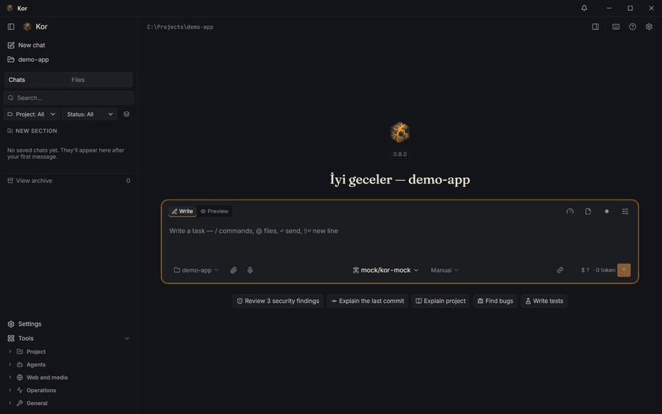
</p>

Kor is a free, open-source coding agent with one native Rust core and three faces: the `kor` command line
(with a full-screen terminal UI), a lightweight Tauri 2 desktop app for Windows, macOS and Linux, and a browser
extension. It works with any of 46 providers or with a model running on your own computer, collects no
telemetry, and can run a complete task with the network unplugged.

> **Status: early release (`v0.8.0`).** The first public build; installers are on the Releases page. Most features
> are covered by automated tests (mock servers and sample projects); real paid APIs and macOS/Linux hardware are
> still being tried. Anything below that needs your own accounts or has not been verified on real hardware is marked as
> such. See [Roadmap and status](#roadmap-and-status).

---

## Table of contents

- [Why Kor?](#why-kor)
- [Screenshots](#screenshots)
- [Feature tour](#feature-tour)
- [How Kor compares](#how-kor-compares)
- [Installation](#installation)
- [Quick start](#quick-start)
- [Configuration](#configuration)
- [Privacy and security](#privacy-and-security)
- [Architecture](#architecture)
- [Updates](#updates)
- [Roadmap and status](#roadmap-and-status)
- [Contributing](#contributing)
- [Translations (i18n)](#translations-i18n)
- [Community](#community)
- [License](#license)
- [Acknowledgements](#acknowledgements)

---

## Why Kor?

Most AI coding tools today share four problems:

| Problem | What it looks like | How Kor answers it |
| --- | --- | --- |
| **Privacy** | Your code, files and every prompt pass through a company's servers. You rarely know how long they are kept or whether they train the next model, and usage telemetry is collected on top. | Zero telemetry, no account, no phone-home. Code goes only to the model you chose. A one-switch privacy mode that keeps everything on the machine, a full offline mode, and a privacy card for every provider so you can see (and enforce) its data policy. |
| **Refusals** | Security testing, reverse engineering, a mature game's script, research on a sensitive subject: the model says "I can't help with that" and stops, even for legitimate work. | Uncensored models are first-class. Kor starts on an uncensored model by default, has an "Uncensored" filter in the model picker, and treats abliterated and local models like any other. |
| **Vendor lock-in** | The tool only works well with one vendor's models, and the features live in that vendor's cloud. | 46 providers plus every common local runtime. The "intelligence" lives in Kor, not in the model: verification, sandbox, project graph, memory and cost control work the same with every model. Models without native tool calling still use tools through a text protocol. |
| **Cost** | Opaque bills, no way to know what a task will cost before you run it. | An estimate before every task and a comparison after it, budgets, a smart router (off by default), a live cost dashboard, `kor cost why`, `kor quota` and `kor bench`. |

A note on "uncensored": in Kor it means the model does not refuse legitimate work (security research on your
own systems, fiction, research, reverse engineering for interoperability). You are responsible for using Kor and
any model lawfully.

---

## Screenshots

> The images below are produced from the current development build and will be refreshed for the first release.

<table>
  <tr>
    <td width="50%">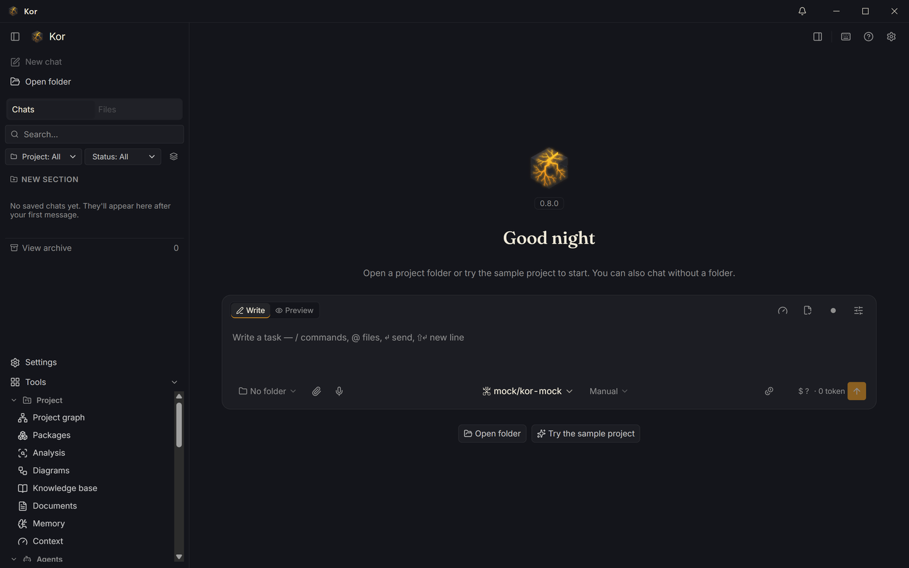<br><sub><b>Home.</b> Recent projects and sessions, the default uncensored model and the privacy state at a glance.</sub></td>
    <td width="50%">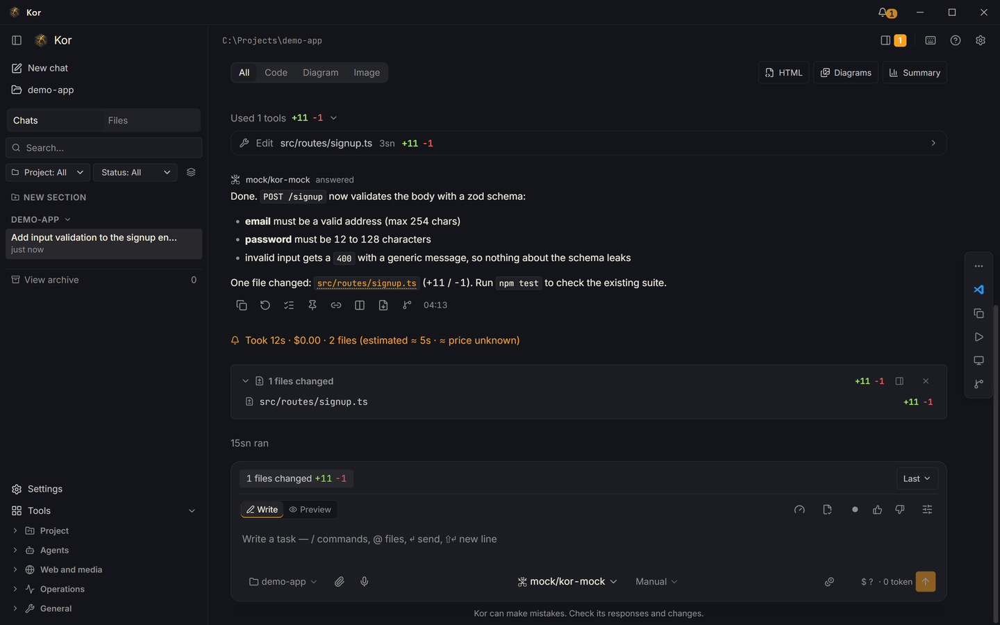<br><sub><b>Chat.</b> The agent's tool calls, live status and per-turn cost in one thread.</sub></td>
  </tr>
  <tr>
    <td>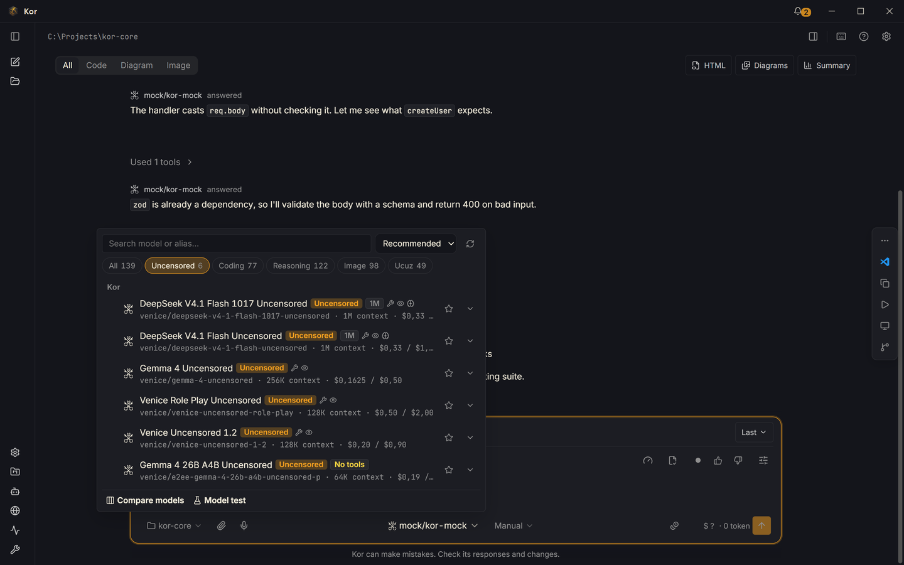<br><sub><b>Model picker.</b> Tabs for All, Uncensored, Coding, Reasoning, Vision and Cheap; privacy badges (training, retention, region) on every row.</sub></td>
    <td>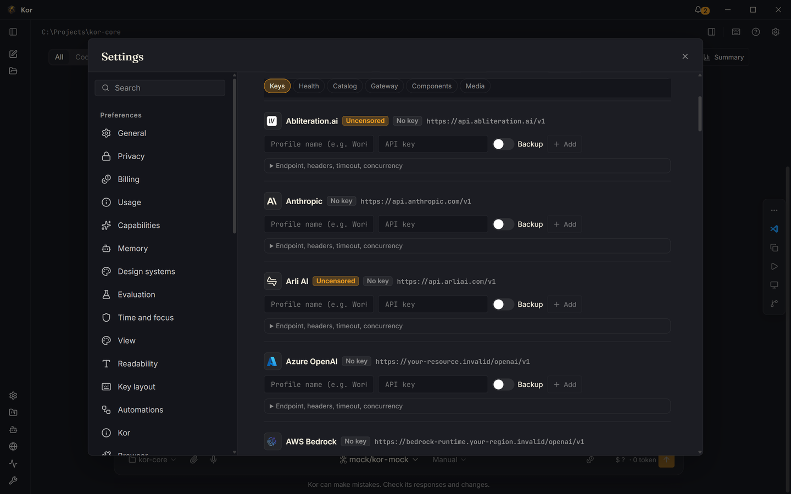<br><sub><b>Providers.</b> Keys go to the OS keychain; local runtimes are detected automatically.</sub></td>
  </tr>
  <tr>
    <td>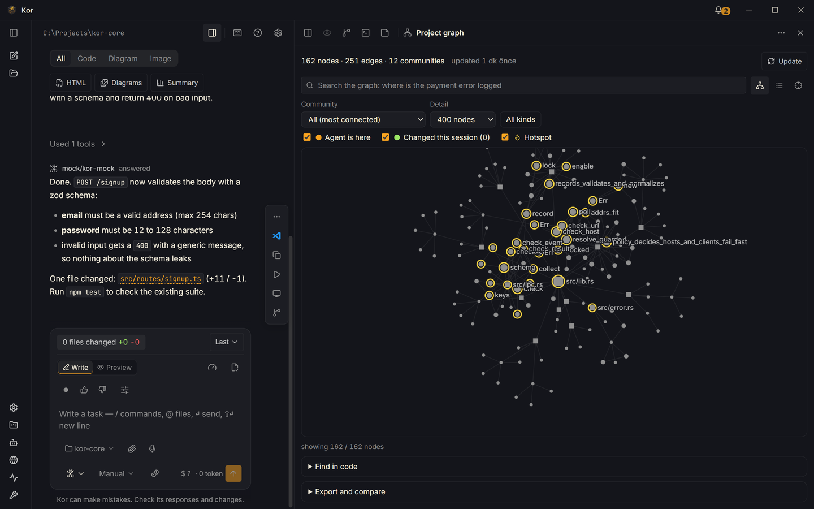<br><sub><b>Project graph.</b> Functions, calls, imports, env keys and tables parsed with tree-sitter; nodes the agent touches light up.</sub></td>
    <td>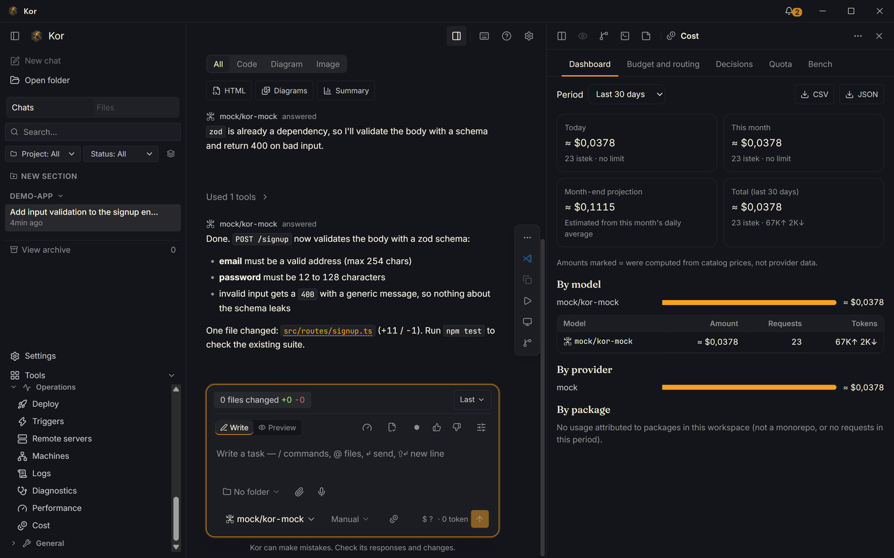<br><sub><b>Cost.</b> Spend per session, model and package, budgets and the estimate-versus-actual comparison.</sub></td>
  </tr>
  <tr>
    <td>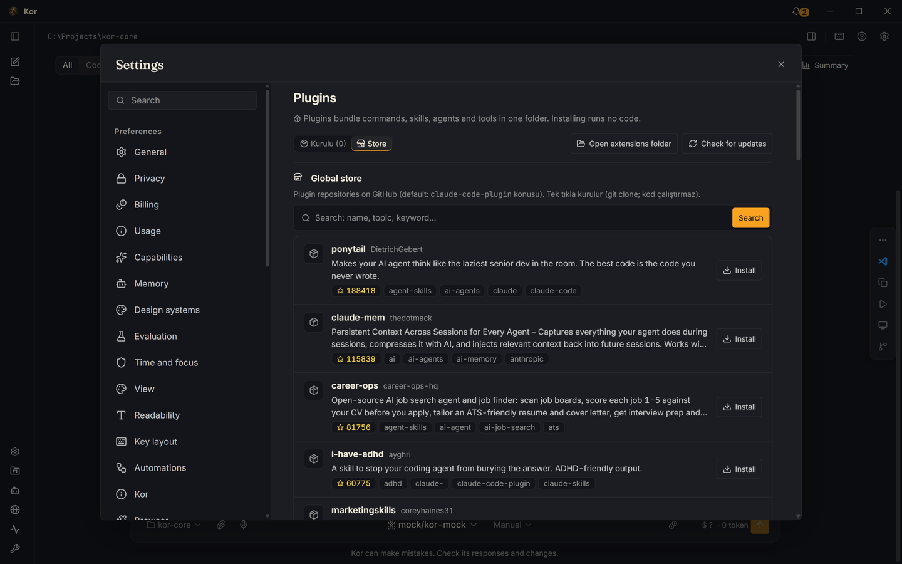<br><sub><b>Plugins.</b> Marketplaces, installed plugins and their commands, agents and skills.</sub></td>
    <td>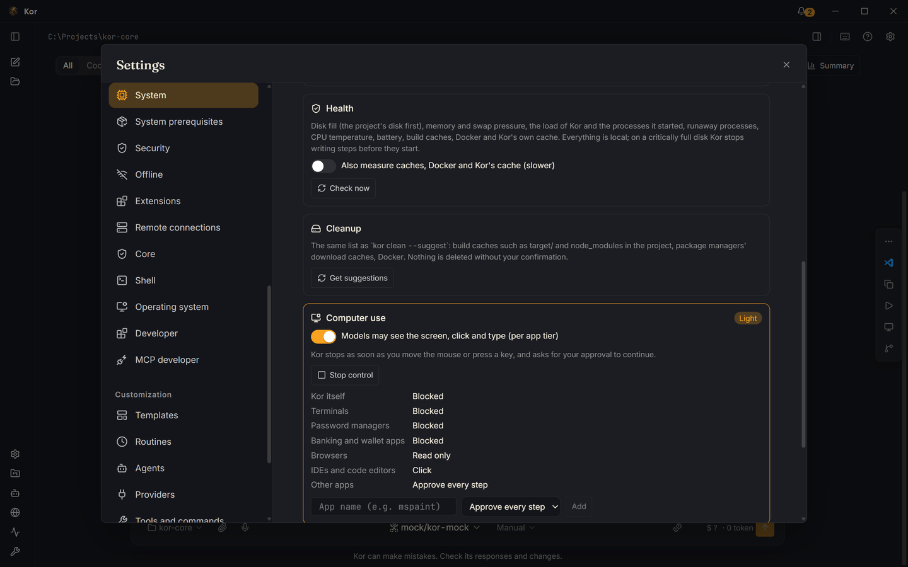<br><sub><b>System.</b> System profile, health alerts (disk, memory, caches) and cleanup with your approval.</sub></td>
  </tr>
  <tr>
    <td>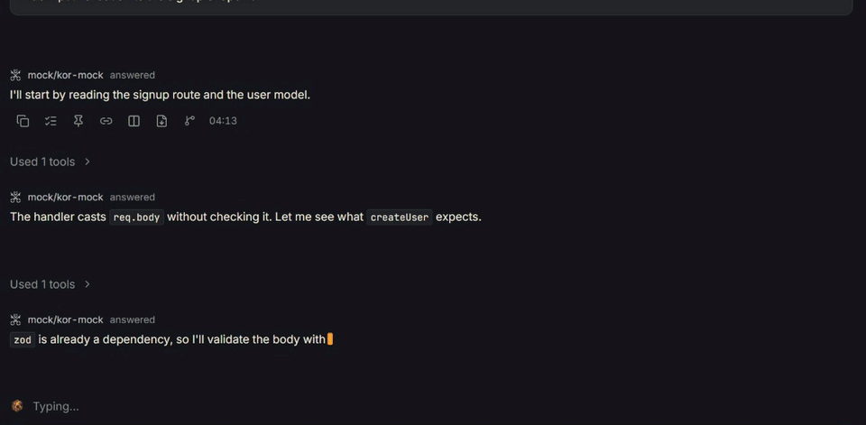<br><sub><b>Per-file approval.</b> Accept, edit or reject each file before it is written; destructive commands are flagged red.</sub></td>
    <td>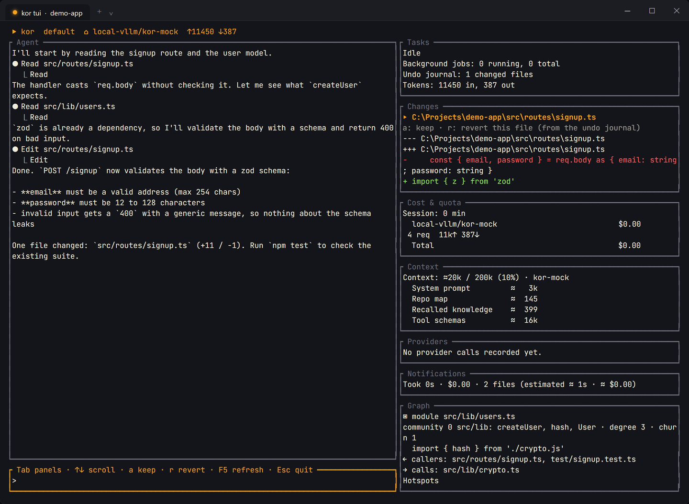<br><sub><b>Terminal UI.</b> <code>kor tui</code>: the same agent, panels and slash commands in a full-screen terminal.</sub></td>
  </tr>
</table>

---

## Feature tour

Every command below exists in the CLI, as a `/slash` command in the interactive terminal, and in the desktop app.
That parity is listed in [`parity.toml`](parity.toml) (about 400 entries) and checked by tests; the one known gap
is `kor update rollback`, which has no desktop button yet.

### Privacy and offline

- **Zero telemetry.** No usage data, no crash upload, no phone-home, no mandatory account.
- **Privacy mode** (`kor --privacy-mode`, `privacy.mode = true`): only local providers; web search, MCP, browser,
  SSH, catalog refresh and update checks are off. One network guard in `kor-core` builds every HTTP client, so the
  rule holds for every crate.
- **Provider privacy cards** (`kor providers privacy`): for each provider, whether it trains on your data, how long
  it keeps it, where it processes it, with the policy URL, the date it was read and a short quote. Unknown values
  are shown as "unknown", never guessed.
- **Enforce a policy** with `privacy.require`: `no-training`, `zero-retention`, `eu-only`, `tr-only`, `local-only`.
  A model that does not meet every requirement cannot be used; the router, fallbacks and summarizer skip it too.
- **Offline and air-gap** (`kor offline init | status | run | bundle | import`): installs a portable llama.cpp server
  and pinned GGUF models (SHA-256 checked), keeps a local copy of the model catalog, and packs everything into one
  archive you can carry on a USB stick.
- **Local semantic search and voice:** an embedding model (multilingual-e5-small) and whisper.cpp run on your
  machine as optional components; neither your code nor your voice leaves it.

### Uncensored and any model

- **Uncensored default:** a fresh install starts on `venice/deepseek-v4-1-flash-uncensored` (requires a Venice API key).
- **"Uncensored" tab** in the model picker, plus Coding, Reasoning, Vision and Cheap tabs and a model comparison view.
- **46 provider manifests** (`backend/providers/*.toml`):

<details>
<summary>All 46 providers</summary>

| Category | Providers |
| --- | --- |
| Uncensored | Venice.ai, Abliteration.ai, Arli AI, Mancer, Refuseless, UncensoredLLM.ai |
| Local runtimes | Ollama, llama.cpp server, LM Studio, vLLM, Jan, KoboldCpp, LocalAI, text-generation-webui |
| Standard APIs | Anthropic, OpenAI, Google AI (Gemini API), DeepSeek, Mistral, Mistral Codestral, Groq, xAI (Grok), Together AI, Fireworks AI, Cerebras, Cohere, Perplexity, SambaNova Cloud, NVIDIA NIM, Moonshot AI (Kimi), Z.ai (GLM), Z.ai GLM Coding Plan, Zhipu AI (BigModel) |
| Aggregators | OpenRouter, Hugging Face Inference Providers, fal.ai (LLM router), Abacus.ai RouteLLM |
| Cloud platforms | Azure OpenAI, Microsoft Foundry Models, AWS Bedrock, Amazon SageMaker, Google Vertex AI, OCI Generative AI, Alibaba Cloud Model Studio (international and China), GitHub Models (retired) |

None of these has been verified against the live API yet (`verified = false` in every manifest); they are tested
against mock servers. An OpenAI-compatible provider needs only a TOML manifest, no code
(see the manifests in [`backend/providers/`](backend/providers/)).

</details>

- **Model-agnostic tool calling:** native tools where the provider supports them, a text tool protocol
  (Hermes/Qwen, Llama, Mistral, fenced JSON) otherwise, with automatic fallback (`agent.tool_mode`).
- **Key pools and failover** (`kor provider add-key`, `kor provider keys`), provider discovery and testing
  (`kor provider discover`, `kor provider test`).
- **Local gateway** (`kor proxy serve`): an OpenAI-, Anthropic- and Gemini-compatible endpoint on localhost, a Rust
  port of CLIProxyAPI.
- **Reads your other tools' rules in place** (`kor compat status | conflicts | export`): Claude Code, Codex, Cursor
  and others; Kor writes only to `.kor/export/`.

### Verified editing and per-file approval

- **Accept / Edit / Reject per file** before anything is written, in the desktop, the REPL and the TUI.
- **Destructive operations** (`rm -rf`, `DROP TABLE`, `git push --force` and similar) are always flagged red and never
  auto-approved.
- **Verified edit loop:** changed files are checked with the project's own checker (`cargo check`, `tsc`,
  `go vet`, `py_compile`, `node --check`) before the turn ends.
- **Rules check:** an edit that breaks the project's rules is sent back to the model before you see it.
- **Plan mode** (`kor plan`, `kor plan approve`): nothing is written until the plan is approved.
- **Undo** (`kor undo`): a per-session journal of every file the agent changed; one command reverts the session.
  Side effects of shell commands (for example `node_modules`) are not yet undone.
- **Permission modes** `default`, `plan`, `accept-edits`, `auto` (auto requires an OS sandbox), with allow/ask/deny
  rules. A project's `.kor/config.toml` can only restrict permissions, never widen them.

### Project graph

- **`kor graph`** parses the code with tree-sitter (about a dozen languages today) into functions, calls, imports,
  env keys, database tables, git co-change and `WHY:`/ADR rationale, stored in SQLite and updated incrementally
  (about 0.1 s for a 110K-line synthetic repo in a release build).
- Queries: `kor graph explain | path | query | hotspots | diff | impact | export | update`; exports to JSON,
  Mermaid, Obsidian, HTML and graphify.
- The agent asks the graph before reading files. A benchmark mode (`kor bench --graph`) compares token use with the
  graph on and off; the target reduction has been measured only with mock models so far.
- **Live diagrams** (`kor diagram sync | watch | check`) in Mermaid, PlantUML and D2, regenerated from code.
- **Database schema layer** (`kor db connect | tables | show | indexes | migrate new | apply`) and monorepo awareness
  (`kor packages affected | deps | cost`) for Cargo, pnpm/yarn/npm, Turborepo, Nx, Lerna, Bazel, Go, Gradle and .NET.

### Cost control and estimates

- **`kor estimate`**: time and cost (≈) before a task; the actual figure is shown next to it afterwards.
- **`kor cost`**, `kor cost why`, `kor cost --export` (CSV/JSON), **`kor quota`** for provider limits.
- **Budgets** (`[budget] daily_limit_usd`, `monthly_limit_usd`, `on_limit = "ask" | "pause" | "downgrade"`).
- **Smart router** (`routing.enabled`, off by default) that sends simple edits to cheap models and verifies with a
  stronger one.
- **`kor bench`**: race models on your own tasks and get a routing suggestion.
- **`kor context`**: what fills the context window, and a context budget manager with automatic summarisation.

### Memory and knowledge base

- **Project memory** in plain Markdown, optionally synced through git notes (`kor memory notes push | pull`).
- **Global knowledge base** (SQLite, full-text search, optional local embeddings): `kor recall`, `kor forget`,
  `kor knowledge export | reindex`, `kor workspace add | list | remove`, `kor know digest | stale`.
- **Docs for the agent** (`kor docs add | search | use`) and reusable **task templates** (`kor templates`, `kor run template:<name>`).

### Multi-agent tasks, triggers, Kor-to-Kor bridge and ACP

- **`kor task "…" --agents 5`**: the goal is split into roles, each sub-agent works in its own git worktree, a reviewer
  checks the work and the results are merged in order; conflicts are shown as a diff. `kor task list | status |
  resume | fork | cancel | resolve`. Not yet run against real providers.
- **Triggers** (`git_push`, cron, webhook, log match) with a background daemon (`kor daemon start | install`) and
  approvals by Telegram, Slack or e-mail (`kor triggers approve | reject`). Tested end to end against mock services.
- **Kor-to-Kor bridge** (`kor peer pair | run | attach | sync | route`): hand a task to your stronger machine at home.
  End-to-end encrypted with the Noise protocol, paired with a one-time code, routed over Tailscale, direct
  connection or SSH. Only tested in simulated environments.
- **Agent Client Protocol** (`kor acp serve | setup`): use Kor as the agent inside editors such as Zed.
- **SSH remote mode and discovery** (`kor --remote`, `kor discover user@host`), **session replay** (`kor replay`),
  **sessions** with fork, tree, compare and merge (`kor sessions …`).

### Computer use and OS integration

- **Computer use:** the agent can see the screen and use the mouse and keyboard, with a tier per application
  (`blocked`, `read`, `click`, `ask`, `full`). Password managers and banking apps are blocked by default, and the agent
  stops as soon as you touch the mouse. `kor computer on | off | allow | status`.
- **OS integration** (`kor os-integration`, `kor integrate`): "Open with Kor" in the file manager's context menu,
  a Windows Terminal profile, Start-menu search, jump lists and a PowerToys Run plugin. Installed once on first desktop
  start and removable at any time. Most of these were tried only in test environments.
- **Shell integration** (`kor shell install`) for PowerShell, bash, zsh and fish: `kor fix` repairs the last failed
  command, `kor why` explains it. The zsh and fish hooks have not been run on real machines yet.
- **System health** (`kor system health`, `kor clean`): warns when the disk fills, memory runs out or build caches
  grow, and cleans up with your approval. **Window layouts** (`kor layout save | restore`) and **system prerequisites**
  (`kor prereq list | install`, always showing the exact command first).

### Browser extension

- A side panel in Chrome, Edge, Brave and Chromium (Firefox build included) connected to the app over a local
  WebSocket (`kor chrome pair | install | status`).
- The agent works only inside its own tab group and never touches password, card or one-time-code fields.
- Apply the documentation page you are reading to your project, fill forms (submitting is left to you) or turn a
  component on a page into code. Per-domain allow and deny lists (`kor chrome allow | deny | domains`).
- Store listings are not published yet; until then the extension is loaded unpacked.

### Media generation

- Image, video, audio and music models from fal, Venice and Hugging Face in one catalogue (`kor media models`).
- Missing parameters are asked on one card and the price is shown before anything is spent (`media.confirm_above`).
- Gallery, derivation chains (variation, upscale, image-to-video, background removal) and background jobs:
  `kor media generate | gallery | derive | jobs | export`, plus `kor hf search | info | download | infer`.
- Uses your own fal, Venice or Hugging Face account; live calls are tested only behind an opt-in flag.

### Natural-language commands

- Type "show my cost", "which tools do I have" or "check dependencies every Monday" and Kor routes it to the right
  command, in Turkish, English or French. Read-only commands run immediately, everything else asks first.
- Built against a fixture set of 500+ sentences with a 95% routing target. `kor intents list | test | add | forget`,
  and a universal tool catalogue (`kor tool list | search | describe | add`).

### Git, pull requests, reviews and code quality

- **`kor commit`** (Conventional Commits message from the diff) and **`kor changelog`**.
- **`kor pr create | review | respond | list | status`** for GitHub, GitLab, Gitea, Bitbucket and Azure DevOps
  (needs your forge token; tested against mock forges).
- **`kor review --persona security`** and other reviewer personas.
- **Security and compliance:** `kor audit --security` (40 built-in rules, plus semgrep and gitleaks when installed),
  `--compliance=kvkk|gdpr`, Markdown/JSON/SARIF output; `kor audit --licenses`, `kor deps check | list` (osv.dev).
- **Quality:** `kor explain`, `kor quality`, `kor debt`, `kor style check`, `kor stats`, `kor impact`, `kor dead-code`,
  `kor perf` (profiler selection, flame graph mapped onto the graph).
- **Deploy and watch:** `kor deploy` with `risk-check`, `kor watch logs | incidents | fix`.

### Webmaster, SEO and the Turkey layer

- **Hosting panels** (`kor host …`): cPanel, Plesk, DirectAdmin and others: SSL, PHP, databases, mail, backups,
  cron, permissions, SFTP.
- **WordPress / WooCommerce** (`kor wp …`): inventory, health, updates, staging, integrity, cleanup, scaffolding.
- **SEO** (`kor seo audit | verify | meta | content | competitors | opportunities`), redirect maps (`kor redirects`),
  proposals and client reports (`kor proposal`, `kor client`). Google Search Console, GA4 and Bing need your own
  OAuth client or API key.
- **Turkey layer** (`kor tr …`): KVKK check, Turkish slugs, VAT (KDV), e-Fatura and e-İrsaliye XML, iyzico/PayTR
  payment templates, marketplace helpers and Turkish keyword tools.

### MCP client and server

- **Client:** `kor mcp add | remove | enable | disable | list | test`; turn a database, OpenAPI or GraphQL spec, or a
  folder into an MCP server (`kor mcp run`); `kor mcp dev` for building your own.
- **Server:** `kor mcp serve` exposes Kor's graph, memory, cost and task tools to other MCP clients.
- **Plugins:** `kor plugin marketplace add`, `kor plugin install | list | enable | update | doctor`. Plugins' commands,
  agents and skills load into the agent.
- **Built-in skills:** 37 skills ship with Kor and install on first run: Addy Osmani's
  [agent-skills](https://github.com/addyosmani/agent-skills) (spec, plan, TDD, review, security, performance, shipping…),
  [humanizer](https://github.com/blader/humanizer), [scroll-craft](https://github.com/nateherkai/scroll-craft),
  [HyperFrames](https://github.com/heygen-com/hyperframes) (HTML to video) and an index of
  [awesome lists](https://github.com/sindresorhus/awesome). Each is listed in the system prompt, so the agent loads the
  one that fits what you wrote; your own skill with the same name wins. HyperFrames' usage beacons and automatic
  feedback reports are removed. Sources, commits and licences: `SOURCES.md` in `assets/builtin-skills.zip`.

### Desktop app

- **Tauri 2, not Electron:** the system WebView with a Rust backend, so the app stays small and starts fast.
- **More than 30 panels:** project graph, packages, cost, context, memory, compatibility, providers, security,
  team, tasks, triggers, peers (Kor-to-Kor), tools, knowledge, diagrams, media, web sites, system, offline,
  replay, rules, hooks, performance and more.
- **Presence:** system tray with a working indicator, notification center, approval queue, picture-in-picture task
  view and a **Ctrl+K command palette** whose "All commands" entry reaches every CLI command.
- **Kor's own motion:** a glowing, sparking ember cube while the agent thinks, plus menu and panel transitions. It
  follows the OS reduced-motion setting and can be switched to always on or off in Settings > Appearance.

### Terminal

- **`kor`** opens the interactive agent; **`kor tui`** is the full-screen interface (default, vim or emacs keys);
  **`kor -p "…" --json`** prints machine-readable output for scripts.
- **Shell completions** for bash, zsh, fish, PowerShell, elvish and nushell (`kor completions <shell>`).
- **`kor doctor --fix`** diagnoses the environment and offers fixes; `kor status`, `kor approve`, `kor deny` handle
  running tasks and approvals from any terminal.

<details>
<summary>Command index (top-level commands)</summary>

`kor` · `acp` · `agents` · `approvals` · `approve` · `attach` · `audit` · `auth` · `bench` · `catalog` · `changelog` ·
`chat` · `chrome` · `clean` · `client` · `commit` · `compat` · `completions` · `component` · `computer` · `config` ·
`connections` · `context` · `cost` · `daemon` · `db` · `dead-code` · `debt` · `deny` · `deploy` · `deps` · `diagram` ·
`discover` · `docs` · `doctor` · `env` · `estimate` · `explain` · `files` · `find` · `fix` · `folder` · `forget` · `graph` ·
`hf` · `hooks` · `host` · `impact` · `integrate` · `intents` · `know` · `knowledge` · `layout` · `mcp` · `media` ·
`memory` · `models` · `mount` · `notifications` · `offline` · `os-integration` · `packages` · `peer` · `perf` · `plan` ·
`plugin` · `pr` · `prereq` · `proposal` · `provider` · `providers` · `proxy` · `quality` · `quota` · `recall` ·
`redirects` · `replay` · `resume` · `review` · `routines` · `rules` · `run` · `sandbox` · `screenshot` · `seo` ·
`sessions` · `shell` · `stats` · `status` · `style` · `system` · `task` · `templates` · `tool` · `tr` · `triggers` ·
`trust` · `tui` · `undo` · `update` · `vault` · `visualize` · `voice` · `watch` · `why` · `workspace` · `wp`

The full list with every subcommand and its TUI and desktop counterpart is [`parity.toml`](parity.toml).

</details>

---

## How Kor compares

A fair, high-level comparison based on each project's public documentation at the time of writing. Products change
quickly; where we are not sure, the cell says "varies". Corrections are welcome.

| | **Kor** | Cursor | Claude Code | Aider | Continue |
| --- | --- | --- | --- | --- | --- |
| Open source | Yes (Apache-2.0 OR MIT) | No | No | Yes (Apache-2.0) | Yes (Apache-2.0) |
| Local / offline models | Yes, full offline mode and air-gap bundle | Varies | No (Anthropic models via API or cloud platforms) | Yes | Yes |
| Uncensored models | First-class: default model, picker filter | No | No | Any model you configure | Any model you configure |
| Telemetry | None | Yes, with a privacy mode | Yes, can be disabled | Opt-in analytics | Varies |
| Desktop app + CLI at parity | Yes, CLI, TUI and desktop, tested | Varies | Varies | CLI only | Varies (IDE extensions and a CLI) |
| Providers | 46 manifests, including 8 local runtimes | Varies | Anthropic, Bedrock, Vertex and similar | Many, via LiteLLM | Many |
| Per-file approval before writing | Yes | Yes | Yes | No (edits applied and committed to git; `/undo`) | Varies |
| OS sandbox for commands | Yes, opt-in (AppContainer, bubblewrap, Seatbelt, Docker) | Varies | Yes (opt-in) | No | Varies |

Kor's strengths are privacy controls, uncensored and local models and surface parity. The others are more mature,
have far larger user bases, and some have editor integrations Kor does not have yet (an LSP server is on the
roadmap).

---

## Installation

### From source (works today)

Prerequisites:

| Tool | Version | Notes |
| --- | --- | --- |
| Rust | stable, 1.88 or newer | Pinned by `backend/rust-toolchain.toml`; installed through `rustup`. |
| Node.js | 24 (23.6 or newer) | For the desktop renderer and build scripts. |
| Python | 3.11 or newer | Release and repository helpers. |
| just | any recent | `cargo install just`, `winget install Casey.Just`, `brew install just` or `apt install just`. |
| Tauri 2 platform prerequisites | — | WebView2 on Windows, WebKitGTK on Linux, Xcode Command Line Tools on macOS. |

```bash
git clone https://github.com/LLCForge/Kor && cd Kor
just setup          # pinned Rust toolchain, rustfmt/clippy, npm packages
just build          # CLI, renderer and desktop app (debug)
just kor doctor     # run the CLI from source
just dev            # run the desktop app with live reload
```

`just` with no arguments lists every recipe (`test`, `lint`, `fmt`, `release`, `prereq`).
The CLI binary lands in `backend/target/debug/`.

### Installers

Every tagged version (`v0.8.0` and later) builds these on GitHub Actions and attaches them to the
[Releases](https://github.com/LLCForge/Kor/releases) page:

| System | Download | Notes |
| --- | --- | --- |
| Windows | `Kor_<version>_x64-setup.exe` (recommended), `.msi` | Branded setup wizard in Turkish, English or French; installs for your user only, so **no administrator rights**; Start menu entry and a "Launch Kor" checkbox at the end. WebView2 is installed silently if missing. |
| macOS | `Kor_<version>_universal.dmg` | Drag Kor to Applications. Apple Silicon and Intel in one file. |
| Linux | `.deb`, `.rpm`, `.AppImage` | Needs glibc 2.39+ (Ubuntu 24.04, Debian 13, Fedora 40 or newer). `.AppImage` runs without installing; make it executable first. |
| CLI only | `kor-<target>.tar.xz` / `.zip` and [`scripts/install.sh`](scripts/install.sh) | Checks SHA-256 and the minisign signature, installs into `~/.local/bin` without sudo. |

**No account, no sign-up.** Kor opens straight away on first launch. It asks for nothing: connect a provider when you
are ready (Settings → Providers: paste an API key, or point it at a local Ollama / LM Studio model). Keys stay in the
OS keychain.

**"Unknown publisher" is expected.** The installers are not code-signed with a paid certificate (a deliberate
decision). Windows SmartScreen shows "Windows protected your PC": choose **More info → Run anyway**. On macOS,
right-click Kor in Applications → **Open** the first time. Updates are still signed: `kor update` and the desktop
updater only install releases whose signature matches the key compiled into Kor.

The desktop installers include the `kor` CLI and can put it on `PATH`. Anything else Kor needs is downloaded into its
own folder when first needed (`kor component add`), or, for the few things only the OS can install, offered with the
exact command and your consent (`kor prereq`). Package-manager listings (winget, Homebrew tap, AUR) come later.

---

## Quick start

The examples use `kor`; from source, use `just kor …` instead.

**1. Check the environment.**

```bash
kor doctor          # add --fix to apply suggested fixes
```

**2. Pick a model.** Either use the uncensored default with a Venice key:

```bash
kor auth login venice      # stores the key in the OS keychain (or set VENICE_API_KEY)
kor provider test venice   # lists models and runs a short streaming test
```

Or stay fully local. If Ollama (or LM Studio, llama.cpp, vLLM …) is already running, Kor detects it:

```bash
kor providers                         # shows detected local runtimes
kor --model local/qwen3:8b            # any model your Ollama has pulled
```

Or let Kor set up a portable runtime and model with no internet needed afterwards:

```bash
kor offline init       # portable llama.cpp + a model of your choice (smallest ~640 MB), asks first
kor offline run        # privacy mode on, local model, full agent
```

On CPU the first turn is slow: Kor's system prompt and tool list are about 26K tokens.

**3. Trust the project and run your first task.**

```bash
cd your-project
kor trust
kor "add a --verbose flag to the CLI and update the tests"
```

Each file change is shown for approval. `kor undo` reverts the session. In the desktop app, open the folder, type the
same request in the composer and use Ctrl+K for every other command.

**4. Script it.**

```bash
kor -p "summarise the open TODOs in src/" --json
```

---

## Configuration

Kor reads layered TOML, lowest to highest: built-in defaults, system, user, project, environment (`KOR_<SECTION>__<KEY>`),
then command-line flags. `kor config explain` shows every effective value and where it came from; `kor config paths`
prints the files; `kor config set <key> <value>` writes a validated value.

| Layer | Windows | macOS | Linux |
| --- | --- | --- | --- |
| System | `%ProgramData%\kor\config.toml` | `/Library/Application Support/kor/config.toml` | `/etc/kor/config.toml` |
| User | `%APPDATA%\kor\config.toml` | `~/Library/Application Support/kor/config.toml` | `$XDG_CONFIG_HOME/kor/config.toml` (default `~/.config/kor/`) |
| Project | `.kor/config.toml` in the project or any parent folder (can only restrict permissions) | same | same |

Key sections:

| Section | What it controls |
| --- | --- |
| `[agent]` | Default model, max turns, tool mode (`auto`/`native`/`text`), verified edits, reasoning effort, rules check |
| `[privacy]` | `mode` (privacy mode), `require` (policy filter), `min_tier` |
| `[sandbox]` | `mode` (`on`/`off`/`ask`), `backend` (`auto`/`native`/`docker`), `network` allowlist, memory and CPU limits, Docker image |
| `[computer]` | `enabled`, and `[computer.apps]` per-application tiers |
| `[integrations]` | First-run OS integrations: context menu, shell integration, individual OS add-ons |
| `[media]` | Ask for missing parameters, confirm above a price, per-model defaults |
| `[perf]` | Low-power mode (`auto`/`on`/`off`), performance log, plugin time budget |

Other sections include `[ui]`, `[permissions]`, `[budget]`, `[routing]`, `[offline]`, `[vault]`, `[update]`,
`[graph]`, `[memory]`, `[intent]`, `[notify]`, `[triggers]` and `[health]`.

<details>
<summary>Example <code>config.toml</code></summary>

```toml
[ui]
language = "auto"              # auto, tr, en, fr

[agent]
model = "venice/deepseek-v4-1-flash-uncensored"
max_turns = 50
tool_mode = "auto"             # native tools when supported, text protocol otherwise
verify = "auto"                # run the project's own checker after edits
rules_check = true

[privacy]
mode = false                   # true = local providers only, every outbound call off
require = ["no-training", "zero-retention"]

[sandbox]
mode = "on"                    # on, off, ask
backend = "auto"               # native backend, Docker when none is available
network = ["registry.npmjs.org:443", "crates.io:443"]   # empty = no network (default)
memory_mb = 8192
cpu_percent = 90

[computer]
enabled = true

[computer.apps]
chrome = "read"                # blocked, read, click, ask, full

[integrations]
auto = true
context_menu = true
shell = true

[media]
ask = true
confirm_above = 0.50           # USD; ask before any media job above this price

[perf]
low_power = "auto"             # turns animations and background work down on weak or battery-low machines

[budget]
daily_limit_usd = 5.0
on_limit = "ask"               # ask, pause, downgrade
```

</details>

---

## Privacy and security

**What leaves your machine, and when**

| Data | Leaves the machine? |
| --- | --- |
| Prompts, file contents, tool results | Only to the model provider you selected, and never in privacy or offline mode unless the provider is local. Secrets are masked first. |
| API keys | Never written to files; kept in the OS keychain (or an encrypted vault file) and sent only to their own provider. |
| Usage data, crash reports | Never. Kor has no telemetry. |
| Model catalogue refresh, update check | Daily at most, from the project's GitHub repository and OpenRouter; off in privacy and offline mode. |
| Web search, MCP servers, browser, SSH, peers | Only when you configure and use them; off in privacy mode. |

- **Privacy card and `privacy.require`.** Policy data lives in
  [`backend/providers/privacy/cards.toml`](backend/providers/privacy/cards.toml), each entry citing the policy page
  and the date it was read. Cards are filled for about a dozen major providers; the rest are "unknown" and therefore
  fail any requirement (fail closed). The KVKK/GDPR hint derived from the region is not legal advice.
- **Offline bundle.** `kor offline bundle` and `kor offline import` move Kor, models and the catalogue to a machine
  with no network; every file is checked by SHA-256. A full task with the network cut (read, edit, run, graph,
  memory, cost) is covered by an automated test with zero non-loopback connections.
- **Secrets vault.** `kor vault add | list | import`: keys in the OS keychain or an encrypted file vault, handed to
  the agent only as environment variables. Every request body sent to a model passes one masking point that
  replaces known keys, vault values and URL passwords.
- **Sandbox per OS.** Off by default; turn it on in Settings or with `kor config set sandbox.mode on`. When on, the network is off by default:

  | Backend | Files | Network | Limits |
  | --- | --- | --- | --- |
  | Windows AppContainer | project and a private temp folder | off (all or nothing) | memory and CPU via job object |
  | Linux bubblewrap | `/` read-only, project read-write | off (all or nothing) | memory per process |
  | macOS Seatbelt | writes only to project and temp | off, or allowed by port | timeouts |
  | Docker | project mounted, rest read-only, all capabilities dropped | off (all or nothing) | memory and CPU |

  `kor sandbox status` shows what is really enforced; `kor sandbox test` should report "blocked". The Windows backend
  is tested; Linux and macOS will be exercised by CI on the first run.
- **Hash-chained audit log.** Every prompt, model call (with cost), file read and write, command and approval is
  appended to `audit.jsonl`; a truncated tail is detected. `kor audit verify`, `kor audit report` (KVKK/GDPR report),
  `kor audit export`.
- **Release integrity.** Sigstore build provenance for every artifact, minisign signatures for raw binaries, signed
  installers per OS once certificates are in place, reproducible builds from the tag.

Report vulnerabilities privately as described in [SECURITY.md](SECURITY.md).

---

## Architecture

One Rust core, three surfaces. The CLI and the desktop app both sit on `kor-runtime`; the desktop never
reimplements core logic.

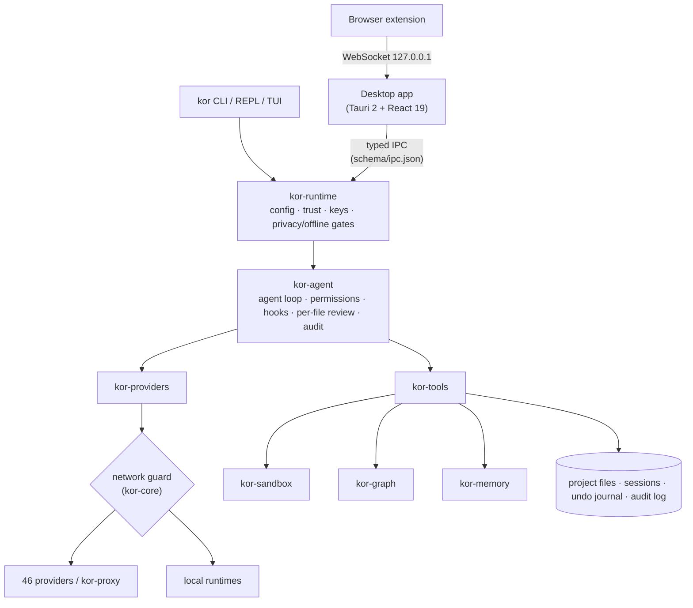

<details>
<summary>Crate map</summary>

| Crate | Responsibility |
| --- | --- |
| `kor-core` | Shared types, the network guard every HTTP client is built from, the IPC schema, the product version |
| `kor-i18n` | Turkish, English and French texts (Fluent, compiled in) |
| `kor-platform` | All operating-system differences behind one API: folders, processes, shell and OS integration, notifications, AppContainer, branding |
| `kor-config` | Layered TOML configuration with per-key provenance |
| `kor-secrets` | Keys in the OS keychain or env, never in files; output redaction and outbound masking |
| `kor-sandbox` | bubblewrap, Seatbelt, AppContainer and Docker wrapping; network allowlist and limits |
| `kor-components` | Verified, resumable downloads of helper programs and models into Kor's own folder |
| `kor-providers` | The `Provider` trait, protocol adapters (OpenAI-compatible, Anthropic, Gemini …), declarative manifests |
| `kor-proxy` | Local OpenAI/Anthropic/Gemini-compatible gateway (Rust port of CLIProxyAPI) |
| `kor-tools` | Built-in tools (files, search, shell, browser, computer use, PDF/OCR), confined to the project root |
| `kor-computer` | Desktop-control policy (per-app tiers, stop on user input) |
| `kor-graph` | The live project graph: tree-sitter parse, resolver, SQLite store, incremental update, communities |
| `kor-memory` | Project memory (Markdown) and the global knowledge base (SQLite, local embeddings) |
| `kor-compat` | Reads other AI coding tools' files in place |
| `kor-health` | System profile, health alerts, cache cleanup |
| `kor-agent` | The agent loop, sessions, sub-agents, MCP, audit log |
| `kor-runtime` | Session assembly shared by CLI and desktop: trust, keys, providers, privacy/offline, updates |
| `kor-web` | Webmaster module: hosting panels, WordPress, technical SEO |
| `kor-cli` | The `kor` binary: commands, REPL, TUI, `doctor` |

</details>

- **IPC contract.** `backend/crates/kor-core/schema/ipc.json` is the single source; the renderer's typed client is
  generated from it, and tests fail when the renderer calls a method the schema does not have.
- **Parity tests.** `parity.toml` lists every CLI command with its TUI slash command and desktop method. A CLI test
  fails when a new command is not listed, a renderer test checks every row is reachable from the palette, and the
  number of allowed gaps can only go down.
- **Platform rule.** OS-specific code lives only in `kor-platform` and `kor-sandbox`; a ratchet test stops it from
  spreading. (A small number of older branches remain and are being moved.)
- **Storage** is plain files: TOML config, JSONL sessions, Markdown memory, SQLite for the graph and the knowledge base.

---

## Updates

- **CLI:** `kor update` checks GitHub Releases, verifies the minisign signature and swaps the binary atomically.
  `kor update check`, `kor update channel stable|beta|nightly`, `kor update rollback`, `kor update --from <file>` for
  offline machines. An unsigned binary is never installed.
- **Automatic check:** at most once a day in interactive sessions, in the background, reported on the next start
  (`[update] auto`, `channel`). Never in privacy mode or CI.
- **Desktop:** the same check in Settings; with the Tauri updater key in place the app downloads and installs in place,
  otherwise it opens the release page. Package-manager installs (winget, Homebrew, apt, Flatpak) are only notified.

None of this can run until the first signed release exists.

---

## Roadmap and status

**Status.** `v0.8.0` is the first public build: it works end to end, but it is early software. What is verified:

- About 400 commands at CLI/TUI/desktop parity, enforced by tests.
- A full offline task with the network cut (automated test), and a real offline turn with llama.cpp and a small
  Qwen model on Windows.
- Sandbox write-blocking on Windows; five-agent task merge without conflicts; git-push trigger to PR loop against
  mock services; graph incremental update under 1 s on a 110K-line repository.
- A UI inspection of 78 screens and about 4,400 controls (labels, contrast, focus rings, clipping, overflow, console
  errors) with **zero open findings**; the release fails if a finding comes back.

Not verified yet: providers against their live APIs (every manifest says `verified = false`), the macOS and Linux
back-ends for OCR, accessibility and sandbox on real machines, and the router/graph savings targets with real models.

### To do

98 open items in total: **65 development tasks**, 12 account/publishing steps for the maintainer, 16 real-world
trials and 5 decisions. The development tasks:

**Faz 8 — team and platform (8)**
- [ ] Kor Server: team mode on your own server (shared rules, graph and memory, task queue, central audit, Postgres, mTLS)
- [ ] OIDC / SSO (Keycloak, Authentik, Google, GitHub) with role-based permissions
- [ ] KaaS API (`POST /api/v1/tasks`, WebSocket, callbacks) and Kor as an OpenAI-compatible model endpoint
- [ ] WASM plugin runtime with signed plugins, permission prompts and a catalogue (`kor plugin search/create`)
- [ ] `kor lsp` for VS Code, Neovim, Zed and JetBrains
- [ ] Team vault and template/hook/rule sync; peer relay through the team server; Faz 8 acceptance tests

**Agent, languages and memory**
- [ ] tree-sitter for 40+ languages (12 today); a docs/PDF concept layer in the graph
- [ ] Hot memory tier and in-RAM HNSW index; a "what was done here" memory summary from imported chats
- [ ] Constrained decoding (`json_schema`, `responseSchema`, llama.cpp grammar)
- [ ] fish-style inline shell suggestions from a small local model
- [ ] Domain-level sandbox network rules, project-name masking in privacy mode, a hard CPU cap on Linux/macOS (today: `nice` priority)
- [ ] Virtual desktops in saved layouts; Windows remote servers

**Providers and cost**
- [ ] SageMaker, Bedrock Converse/IAM, Vertex ADC, Azure Entra ID, OCI signed auth
- [ ] Codestral FIM, Cohere embed/rerank; leaderboard scores (HF, LMArena, LiveBench) in the catalogue
- [ ] Proxy quota in `kor quota`; Prometheus endpoint

**Web, media and integrations**
- [ ] Turkish payment, cargo, marketplace and registrar adapters; backlink tools; bulk keyword opportunities
- [ ] Direct media providers (OpenAI Images, Imagen/Veo, Stability, Runway, Luma) and local ComfyUI
- [ ] Forge: fix from CI status, issue → task, release notes, Bitbucket Server

**UI**
- [ ] Spread the remaining side-panel views over the left rail and settings
- [ ] Gallery media in the Chrome side panel

**Testing, release and code health**
- [ ] `PERFORMANCE.md`, benchmark history and E2E report per release; coverage with an 80 % gate; nightly live smoke test
- [ ] CLI help/error snapshots; macOS desktop E2E; reproducible builds; PGO
- [ ] Move business logic out of the desktop bridge; split the largest crates; `deny(missing_docs)`; user and plugin guides

The full list, with spec references and file paths, is kept by the maintainer and summarised here at every release.

---

## Contributing

Contributions are welcome. Start with [CONTRIBUTING.md](CONTRIBUTING.md).

```bash
just fmt          # rustfmt
just lint         # clippy -D warnings, TypeScript strict, design checks
just test         # Rust, renderer and tooling tests
```

- Architectural changes (a new crate, a new dependency between crates, a new storage format, a new network
  destination) need an issue first to agree on the design.
- Conventional Commits, signed off (`git commit -s`) for the Developer Certificate of Origin.
- No telemetry, no network call to a destination the user did not configure, no secrets in logs.
- OSI-approved dependency licences only.

Kor makes no money:
no paid tier, licence key or mandatory account.

## Translations (i18n)

The interface is available in **Turkish, English and French**; every user-facing string must exist in all three.

- CLI and TUI: `backend/crates/kor-i18n/locales/{en,tr,fr}/kor.ftl` (Fluent). The `every_locale_has_the_same_keys`
  test fails on a missing key. French uses a narrow no-break space before `: ; ? !`.
- Desktop: Turkish source strings with English and French catalogues in
  `frontend/src/desktop/renderer/i18n/` (`en.json`, `fr.json`).

A new language is a new folder of `.ftl` files plus a renderer catalogue; open an issue first so we can agree on
the locale code.

## Community

- Questions, ideas and bug reports: [GitHub Issues](https://github.com/LLCForge/Kor/issues). Issues labelled
  `good first issue` and `help wanted` are good starting points.
- Security issues: privately, through [SECURITY.md](SECURITY.md).
- Everyone is expected to follow the [Code of Conduct](CODE_OF_CONDUCT.md).
- Changes are recorded in [backend/CHANGELOG.md](backend/CHANGELOG.md).

## License

Kor is dual-licensed under [Apache-2.0](LICENSE-APACHE) or [MIT](LICENSE-MIT), at your option. Brand assets in
`assets/` are CC-BY-4.0 and third-party asset licences are listed in [assets/LICENSES.toml](assets/LICENSES.toml).
Maintained by LLCForge and contributors.

## Acknowledgements

- **[Venice.ai](https://venice.ai)** for private, uncensored inference, which powers Kor's default model.
- **[Artificial Analysis](https://artificialanalysis.ai)** for the intelligence and coding indexes shown in the model
  picker and comparison view (data attributed in the catalogue and in `kor catalog`).
- **[OpenRouter](https://openrouter.ai)** and **[Hugging Face](https://huggingface.co)** for the public model metadata
  behind the catalogue.
- **[CLIProxyAPI](https://github.com/router-for-me/CLIProxyAPI)**, which `kor-proxy` ports to Rust.
- The authors of the built-in skills: [Addy Osmani](https://github.com/addyosmani/agent-skills) (MIT),
  [blader](https://github.com/blader/humanizer) (MIT), [Nate Herk](https://github.com/nateherkai/scroll-craft) (MIT),
  [HeyGen](https://github.com/heygen-com/hyperframes) (Apache-2.0) and [Sindre Sorhus](https://github.com/sindresorhus/awesome) (CC0).
- The open-source projects Kor is built on, among them [Tauri](https://tauri.app), [tree-sitter](https://tree-sitter.github.io),
  [llama.cpp](https://github.com/ggml-org/llama.cpp), [whisper.cpp](https://github.com/ggml-org/whisper.cpp),
  [candle](https://github.com/huggingface/candle), [ratatui](https://ratatui.rs), [Tokio](https://tokio.rs),
  [clap](https://github.com/clap-rs/clap), [rusqlite](https://github.com/rusqlite/rusqlite),
  [petgraph](https://github.com/petgraph/petgraph), [snow](https://github.com/mcginty/snow) (Noise protocol),
  [Fluent](https://projectfluent.org), [PDFium](https://pdfium.googlesource.com/pdfium/), [enigo](https://github.com/enigo-rs/enigo),
  [xcap](https://github.com/nashaofu/xcap), [React](https://react.dev) and the
  [Figtree](https://github.com/erikdkennedy/figtree) typeface (OFL).
