<!-- SPDX-License-Identifier: Apache-2.0 OR MIT -->

<p align="right"><b>Türkçe</b> · <a href="README.md">English</a></p>

<p align="center">
  
</p>

<h1 align="center">Kor</h1>

<p align="center"><b>Gizlilik odaklı, sansürsüz, modele bağlı olmayan kod ajanı. Senin modelin, senin bilgisayarın, senin verin.</b></p>

<p align="center">
  <a href="https://github.com/LLCForge/Kor/actions/workflows/ci.yml"></a>
  <a href="#lisans"></a>
  
  
  
  
  
</p>

<p align="center">
  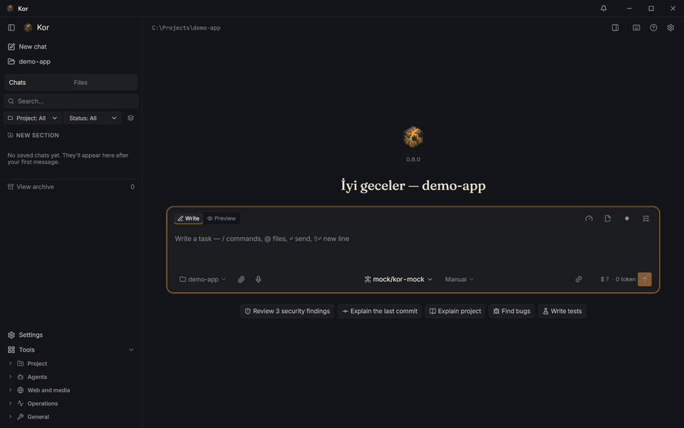
</p>

Kor, tek bir yerel Rust çekirdeği ve üç yüzü olan ücretsiz, açık kaynak bir kod ajanıdır: `kor` komut satırı (tam
ekran terminal arayüzüyle birlikte), Windows, macOS ve Linux için hafif bir Tauri 2 masaüstü uygulaması ve bir
tarayıcı eklentisi. 46 sağlayıcıdan herhangi biriyle ya da kendi bilgisayarında çalışan bir modelle çalışır,
telemetri toplamaz ve ağ kablosu çekiliyken bile bir görevi baştan sona yürütebilir.

> **Durum: erken sürüm (`v0.8.0`).** İlk açık derleme; kurulum paketleri Releases sayfasında. Özelliklerin çoğu
> otomatik testlerle (sahte sunucular ve örnek projelerle) doğrulandı; gerçek ücretli API'ler ve macOS/Linux
> donanımı üzerinde denemeler sürüyor. Aşağıda kendi hesaplarını gerektiren ya da gerçek donanımda doğrulanmamış her şey ayrıca
> belirtildi. Ayrıntı: [Yol haritası ve durum](#yol-haritası-ve-durum).

---

## İçindekiler

- [Neden Kor?](#neden-kor)
- [Ekran görüntüleri](#ekran-görüntüleri)
- [Özellik turu](#özellik-turu)
- [Kor ve diğerleri](#kor-ve-diğerleri)
- [Kurulum](#kurulum)
- [Hızlı başlangıç](#hızlı-başlangıç)
- [Yapılandırma](#yapılandırma)
- [Gizlilik ve güvenlik](#gizlilik-ve-güvenlik)
- [Mimari](#mimari)
- [Güncellemeler](#güncellemeler)
- [Yol haritası ve durum](#yol-haritası-ve-durum)
- [Katkıda bulunma](#katkıda-bulunma)
- [Çeviriler (i18n)](#çeviriler-i18n)
- [Topluluk](#topluluk)
- [Lisans](#lisans)
- [Teşekkürler](#teşekkürler)

---

## Neden Kor?

Bugünkü yapay zekâ kod araçlarının çoğunda dört ortak sorun var:

| Sorun | Nasıl görünüyor | Kor'un cevabı |
| --- | --- | --- |
| **Gizlilik** | Kodun, dosyaların ve yazdığın her istem bir şirketin sunucusundan geçiyor. Ne kadar saklandığını, bir sonraki modelin eğitiminde kullanılıp kullanılmadığını çoğu zaman bilmiyorsun; üstüne kullanım verisi (telemetri) toplanıyor. | Sıfır telemetri, hesap yok, "ev arama" yok. Kodun yalnızca senin seçtiğin modele gider. Her şeyi makinede tutan tek anahtarlı gizlilik modu, tam çevrimdışı mod ve her sağlayıcının veri politikasını gösteren (ve zorunlu kılabileceğin) gizlilik kartı. |
| **Retler** | Güvenlik testi, tersine mühendislik, yetişkinlere yönelik bir oyunun metni, hassas bir konuda araştırma: model "bu konuda yardımcı olamam" deyip duruyor, meşru bir iş için bile. | Sansürsüz modeller birinci sınıf. Kor varsayılan olarak sansürsüz bir modelle açılır, model seçicide "Sansürsüz" filtresi vardır, abliterated ve yerel modellere diğerleri gibi davranır. |
| **Tek sağlayıcıya bağımlılık** | Araç yalnızca tek bir firmanın modelleriyle iyi çalışıyor, özellikler o firmanın bulutunda yaşıyor. | 46 sağlayıcı ve yaygın bütün yerel çalıştırıcılar. "Zekâ" modelde değil Kor'un içinde: doğrulama, sandbox, proje grafı, hafıza ve maliyet kontrolü her modelle aynı çalışır. Yerel araç çağırma desteği olmayan modeller bile metin protokolüyle araç kullanır. |
| **Maliyet** | Belirsiz faturalar; bir görevin ne tutacağını çalıştırmadan bilmenin yolu yok. | Her görevden önce tahmin, sonra gerçekleşenle karşılaştırma; bütçeler, akıllı yönlendirici (varsayılan kapalı), canlı maliyet panosu, `kor cost why`, `kor quota` ve `kor bench`. |

"Sansürsüz" üzerine bir not: Kor'da bu, modelin meşru işleri (kendi sistemlerinde güvenlik araştırması, kurgu,
araştırma, birlikte çalışabilirlik için tersine mühendislik) reddetmemesi anlamına gelir. Kor'u ve herhangi bir
modeli yasalara uygun kullanmaktan sen sorumlusun.

---

## Ekran görüntüleri

> Aşağıdaki görseller güncel geliştirme sürümünden alındı; ilk sürümle birlikte yenilenecek.

<table>
  <tr>
    <td width="50%">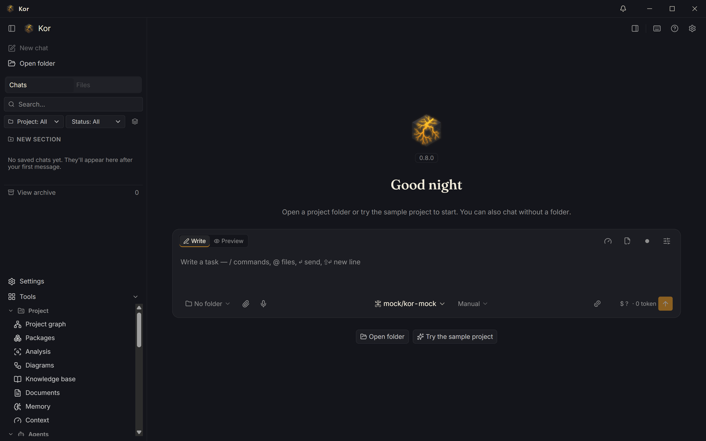<br><sub><b>Ana ekran.</b> Son projeler ve oturumlar, varsayılan sansürsüz model ve gizlilik durumu tek bakışta.</sub></td>
    <td width="50%">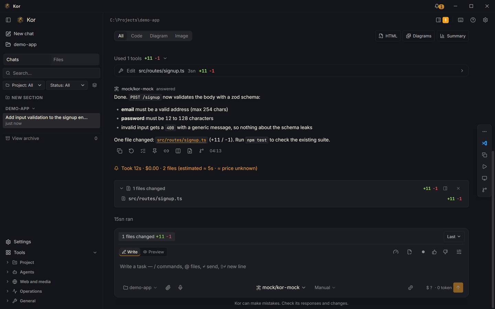<br><sub><b>Sohbet.</b> Ajanın araç çağrıları, canlı durumu ve tur başına maliyeti tek akışta.</sub></td>
  </tr>
  <tr>
    <td>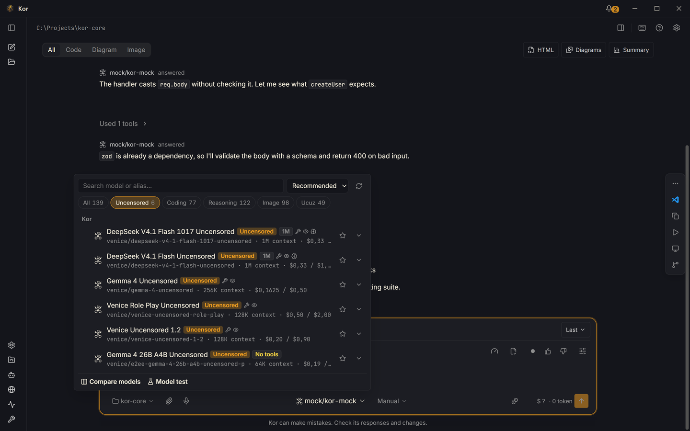<br><sub><b>Model seçici.</b> Tümü, Sansürsüz, Kodlama, Akıl yürütme, Görsel ve Ucuz sekmeleri; her satırda gizlilik rozeti (eğitim, saklama, bölge).</sub></td>
    <td>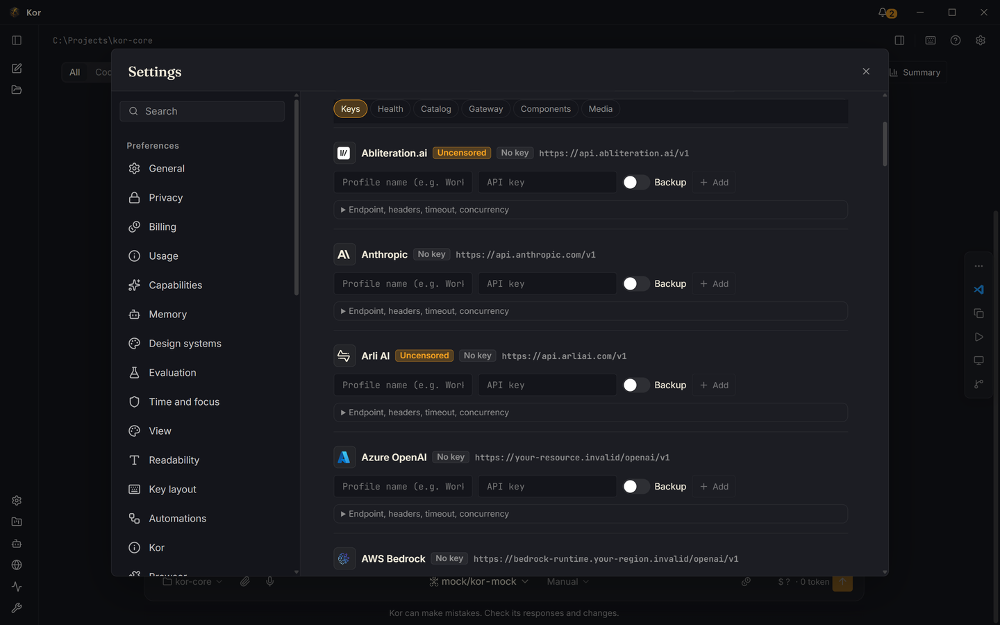<br><sub><b>Sağlayıcılar.</b> Anahtarlar işletim sisteminin anahtarlığına gider; yerel çalıştırıcılar kendiliğinden bulunur.</sub></td>
  </tr>
  <tr>
    <td>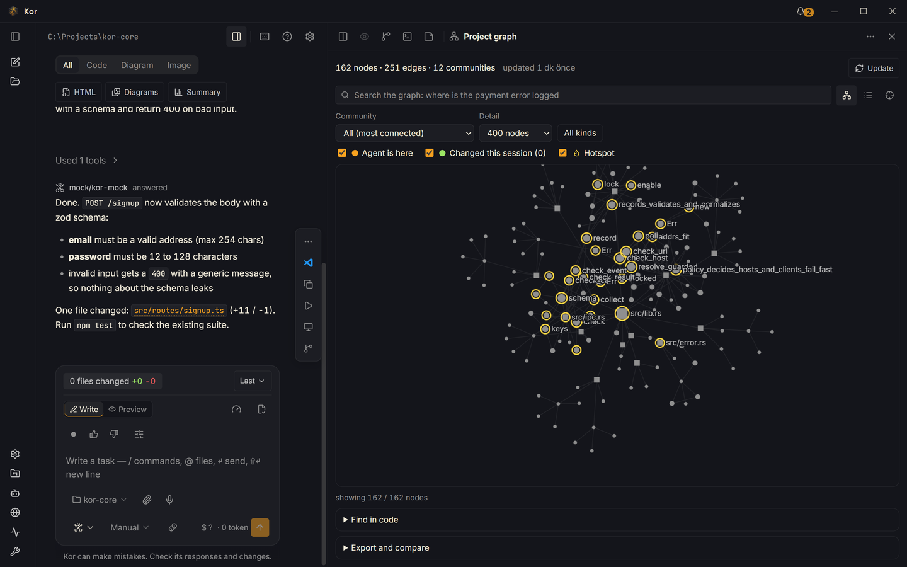<br><sub><b>Proje grafı.</b> tree-sitter ile ayrıştırılan fonksiyonlar, çağrılar, importlar, env anahtarları ve tablolar; ajanın dokunduğu düğümler yanıp söner.</sub></td>
    <td>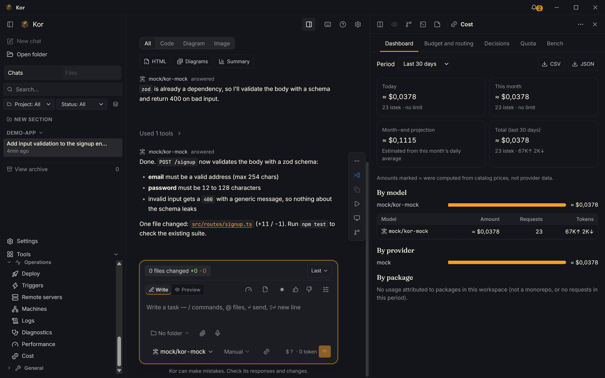<br><sub><b>Maliyet.</b> Oturum, model ve paket başına harcama, bütçeler ve tahmin-gerçekleşen karşılaştırması.</sub></td>
  </tr>
  <tr>
    <td>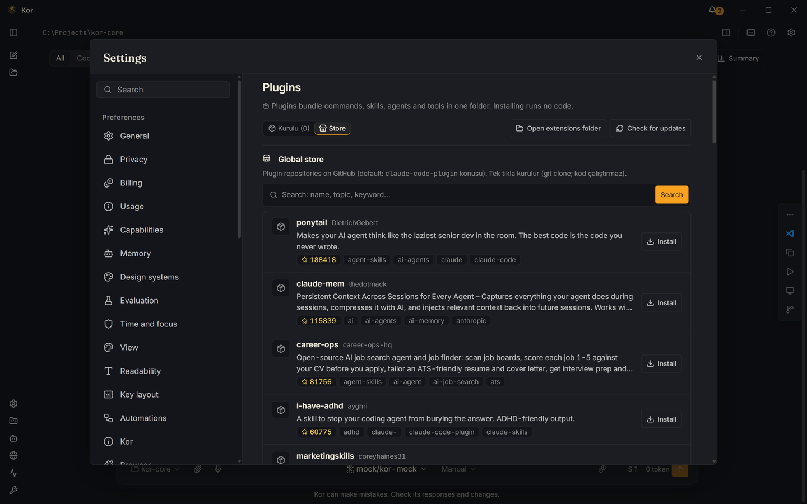<br><sub><b>Eklentiler.</b> Pazar yerleri, kurulu eklentiler ve onların komutları, ajanları ve becerileri.</sub></td>
    <td>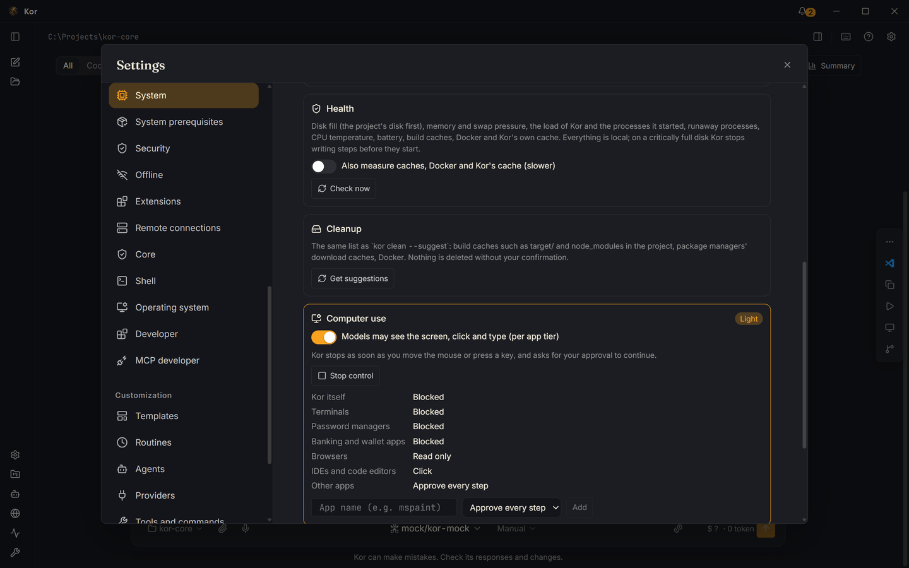<br><sub><b>Sistem.</b> Sistem profili, sağlık uyarıları (disk, bellek, önbellekler) ve onayınla temizlik.</sub></td>
  </tr>
  <tr>
    <td>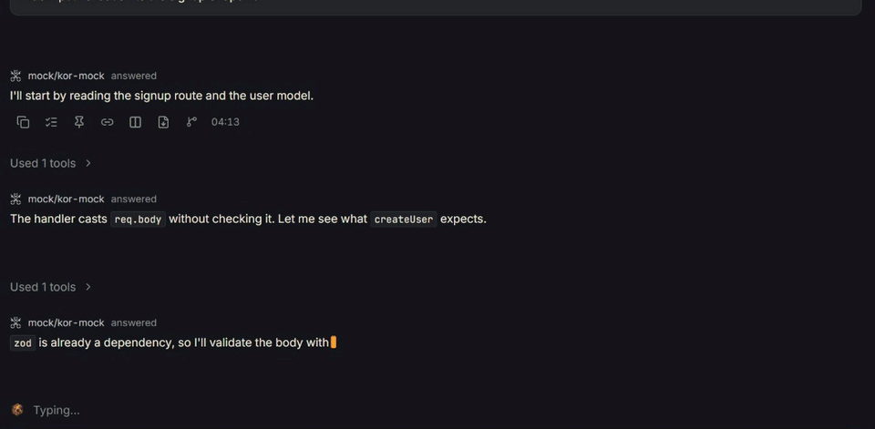<br><sub><b>Dosya dosya onay.</b> Her dosya yazılmadan önce kabul et, düzenle ya da reddet; yıkıcı komutlar kırmızı işaretlenir.</sub></td>
    <td>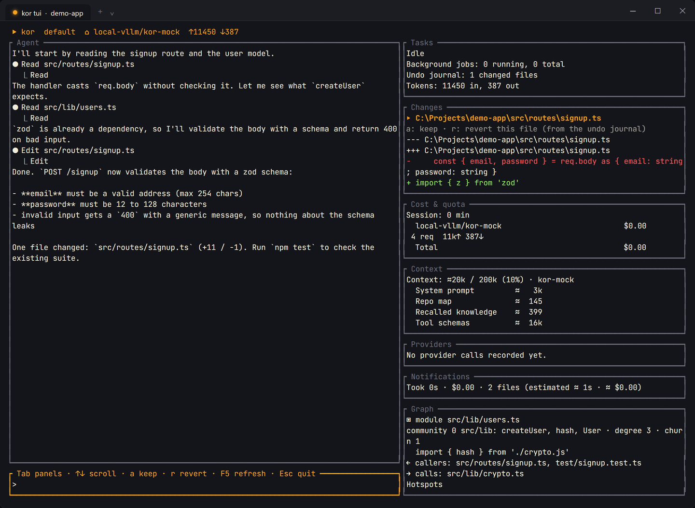<br><sub><b>Terminal arayüzü.</b> <code>kor tui</code>: aynı ajan, paneller ve slash komutları tam ekran terminalde.</sub></td>
  </tr>
</table>

---

## Özellik turu

Aşağıdaki her komut CLI'da, etkileşimli terminalde `/slash` komutu olarak ve masaüstü uygulamasında bulunur. Bu
eşitlik [`parity.toml`](parity.toml) dosyasında (yaklaşık 400 satır) listelenir ve testlerle korunur; bilinen tek
boşluk, henüz masaüstü düğmesi olmayan `kor update rollback`.

### Gizlilik ve çevrimdışı çalışma

- **Sıfır telemetri.** Kullanım verisi yok, çökme raporu yüklemesi yok, "ev arama" yok, zorunlu hesap yok.
- **Gizlilik modu** (`kor --privacy-mode`, `privacy.mode = true`): yalnızca yerel sağlayıcılar; web araması, MCP,
  tarayıcı, SSH, katalog yenileme ve güncelleme denetimi kapalı. `kor-core` içindeki tek ağ kapısı bütün HTTP
  istemcilerini kurduğu için kural her crate'te geçerlidir. İşletim sisteminin Kor dışında gösterdiği masaüstü
  bildirimleri ve görev çubuğu atlama listesi projeleri klasör adı yerine takma adla (`proje-1a2b`) gösterir.
- **Sağlayıcı gizlilik kartları** (`kor providers privacy`): her sağlayıcı için verini eğitimde kullanıp kullanmadığı,
  ne kadar sakladığı, hangi bölgede işlediği; politika adresi, okunduğu tarih ve kısa bir alıntıyla. Bilinmeyen
  değerler "bilinmiyor" diye yazılır, asla tahmin edilmez.
- **Politikayı zorunlu kıl:** `privacy.require` ile `no-training`, `zero-retention`, `eu-only`, `tr-only`,
  `local-only`. Şartların hepsini karşılamayan model kullanılamaz; yönlendirici, yedek modeller ve özetleyici de onu atlar.
- **Çevrimdışı ve air-gap** (`kor offline init | status | run | bundle | import`): taşınabilir bir llama.cpp sunucusu ve
  sürümü sabitlenmiş GGUF modelleri (SHA-256 doğrulamalı) kurar, model kataloğunun yerel bir kopyasını tutar ve
  hepsini USB bellekle taşınabilecek tek bir arşive koyar.
- **Yerel anlamsal arama ve ses:** bir gömme modeli (multilingual-e5-small) ve whisper.cpp isteğe bağlı bileşenler
  olarak senin makinende çalışır; ne kodun ne sesin dışarı çıkar.

### Sansürsüz ve her model

- **Sansürsüz varsayılan:** yeni kurulum `venice/deepseek-v4-1-flash-uncensored` ile açılır (Venice API anahtarı gerekir).
- Model seçicide **"Sansürsüz" sekmesi**, ayrıca Kodlama, Akıl yürütme, Görsel ve Ucuz sekmeleri ve model karşılaştırma görünümü.
- **46 sağlayıcı manifestosu** (`backend/providers/*.toml`):

<details>
<summary>46 sağlayıcının tamamı</summary>

| Kategori | Sağlayıcılar |
| --- | --- |
| Sansürsüz | Venice.ai, Abliteration.ai, Arli AI, Mancer, Refuseless, UncensoredLLM.ai |
| Yerel çalıştırıcılar | Ollama, llama.cpp sunucusu, LM Studio, vLLM, Jan, KoboldCpp, LocalAI, text-generation-webui |
| Standart API'ler | Anthropic, OpenAI, Google AI (Gemini API), DeepSeek, Mistral, Mistral Codestral, Groq, xAI (Grok), Together AI, Fireworks AI, Cerebras, Cohere, Perplexity, SambaNova Cloud, NVIDIA NIM, Moonshot AI (Kimi), Z.ai (GLM), Z.ai GLM Coding Plan, Zhipu AI (BigModel) |
| Toplayıcılar | OpenRouter, Hugging Face Inference Providers, fal.ai (LLM yönlendirici), Abacus.ai RouteLLM |
| Bulut platformları | Azure OpenAI, Microsoft Foundry Models, AWS Bedrock (API anahtarı ya da Converse API ile IAM), Amazon SageMaker (IAM), Google Vertex AI, OCI Generative AI, Alibaba Cloud Model Studio (uluslararası ve Çin), GitHub Models (kullanımdan kalktı) |

Bunların hiçbiri henüz canlı API'ye karşı doğrulanmadı (her manifestoda `verified = false`); sahte sunucularla test
edildiler. OpenAI uyumlu bir sağlayıcı yalnızca bir TOML manifestosu ister, kod gerekmez
([`backend/providers/`](backend/providers/) altındaki manifestolara bak).

</details>

- **Modele bağlı olmayan araç çağırma:** sağlayıcı destekliyorsa yerel araçlar, desteklemiyorsa metin araç protokolü
  (Hermes/Qwen, Llama, Mistral, çitli JSON); otomatik geri dönüşle (`agent.tool_mode`).
- **Anahtar havuzu ve yedekleme** (`kor provider add-key`, `kor provider keys`), sağlayıcı keşfi ve testi
  (`kor provider discover`, `kor provider test`).
- **Yerel ağ geçidi** (`kor proxy serve`): localhost üzerinde OpenAI, Anthropic ve Gemini uyumlu bir uç; CLIProxyAPI'nin
  Rust'a taşınmış hali.
- **Diğer araçlarının kurallarını yerinde okur** (`kor compat status | conflicts | export`): Claude Code, Codex,
  Cursor ve diğerleri; Kor yalnızca `.kor/export/` altına yazar.

### Doğrulamalı düzenleme ve dosya dosya onay

- Her şey yazılmadan önce **dosya başına Kabul / Düzenle / Reddet**; masaüstünde, REPL'de ve TUI'de.
- **Yıkıcı işlemler** (`rm -rf`, `DROP TABLE`, `git push --force` ve benzerleri) her zaman kırmızı işaretlenir, asla
  otomatik onaylanmaz.
- **Doğrulamalı düzenleme döngüsü:** değişen dosyalar tur bitmeden projenin kendi denetleyicisiyle (`cargo check`,
  `tsc`, `go vet`, `py_compile`, `node --check`) kontrol edilir.
- **Kural denetimi:** projenin kurallarını çiğneyen bir düzenleme, sen görmeden modele geri gönderilir.
- **Plan modu** (`kor plan`, `kor plan approve`): plan onaylanmadan tek dosya yazılmaz.
- **Geri alma** (`kor undo`): ajanın değiştirdiği her dosyanın oturum başına günlüğü; tek komut oturumu geri alır.
  Kabuk komutlarının yan etkileri (ör. `node_modules`) henüz geri alınmıyor.
- **İzin modları** `default`, `plan`, `accept-edits`, `auto` (auto bir OS sandbox'ı ister); izin/sor/reddet kurallarıyla.
  Projedeki `.kor/config.toml` izinleri yalnızca kısıtlayabilir, asla genişletemez.

### Proje grafı

- **`kor graph`** kodu tree-sitter ile (Rust, Python ve TypeScript'ten Kotlin, Swift, Haskell, Zig, Terraform, SQL ve Verilog'a 46 dil) ayrıştırır: fonksiyonlar, çağrılar, importlar,
  env anahtarları, veritabanı tabloları, doküman bölümleri (Markdown ve PDF), git'te birlikte değişen dosyalar ve `WHY:`/ADR gerekçeleri. SQLite'ta saklanır
  ve artımlı güncellenir (release derlemede 110 bin satırlık sentetik depoda yaklaşık 0,1 sn).
- Sorgular: `kor graph explain | path | query | hotspots | diff | impact | export | update`; JSON, Mermaid, Obsidian,
  HTML ve graphify biçimlerine dışa aktarım.
- Ajan dosya okumadan önce grafa sorar. Karşılaştırma modu (`kor bench --graph`) graf açıkken ve kapalıyken token
  kullanımını ölçer; hedeflenen azalma şimdilik yalnızca sahte modellerle ölçüldü.
- **Canlı diyagramlar** (`kor diagram sync | watch | check`): Mermaid, PlantUML ve D2; koddan yeniden üretilir.
- **Veritabanı şeması katmanı** (`kor db connect | tables | show | indexes | migrate new | apply`; `apply` yıkıcı SQL'i önce kopyada dener: SQLite dosyası, Postgres şablon veritabanı, 1 milyon satıra kadar MySQL kopyası, SQL Server'da geri alınan işlem) ve monorepo
  farkındalığı (`kor packages affected | deps | cost`): Cargo, pnpm/yarn/npm, Turborepo, Nx, Lerna, Bazel, Go, Gradle ve .NET.

### Maliyet kontrolü ve tahminler

- **`kor estimate`**: görevden önce süre ve maliyet tahmini (≈); görev bitince gerçekleşen yanında gösterilir.
- **`kor cost`**, `kor cost why`, `kor cost --export` (CSV/JSON), sağlayıcı limitleri için **`kor quota`**.
- **Bütçeler** (`[budget] daily_limit_usd`, `monthly_limit_usd`, `on_limit = "ask" | "pause" | "downgrade"`).
- **Akıllı yönlendirici** (`routing.enabled`, varsayılan kapalı): basit düzenlemeleri ucuz modellere gönderir, daha
  güçlü bir modelle doğrular.
- **`kor bench`**: modelleri kendi görevlerinde yarıştır, yönlendirme önerisi al.
- **`kor context`**: bağlam penceresini neyin doldurduğu; otomatik özetlemeli bağlam bütçesi yöneticisi.

### Hafıza ve bilgi tabanı

- Düz Markdown olarak **proje hafızası**; istersen git notes ile senkron (`kor memory notes push | pull`).
- **Genel bilgi tabanı** (SQLite, tam metin arama, isteğe bağlı yerel gömmeler): `kor recall`, `kor forget`,
  `kor knowledge export | reindex`, `kor workspace add | list | remove`, `kor know digest | stale`.
- **Ajan için dokümanlar** (`kor docs add | search | use`) ve yeniden kullanılabilir **görev şablonları**
  (`kor templates`, `kor run template:<ad>`).

### Çok ajanlı görevler, tetikleyiciler, Kor-to-Kor köprüsü ve ACP

- **`kor task "…" --agents 5`**: hedef rollere bölünür, her alt ajan kendi git worktree'sinde çalışır, bir inceleyici
  işi denetler ve sonuçlar sırayla birleştirilir; çakışmalar diff olarak gösterilir. `kor task list | status | resume |
  fork | cancel | resolve`. Gerçek sağlayıcılarla henüz koşturulmadı.
- **Tetikleyiciler** (`git_push`, cron, webhook, günlük eşleşmesi), arka plan servisi (`kor daemon start | install`) ve
  Telegram, Slack ya da e-postayla onay (`kor triggers approve | reject`). Sahte servislerle uçtan uca test edildi.
- **Kor-to-Kor köprüsü** (`kor peer pair | run | attach | sync | route`): görevi evdeki güçlü bilgisayarına devret.
  Noise protokolüyle uçtan uca şifreli, tek kullanımlık kodla eşleşme; Tailscale, doğrudan bağlantı ya da SSH
  üzerinden. Yalnızca benzetilmiş ortamlarda denendi.
- **Agent Client Protocol** (`kor acp serve | setup`): Kor'u Zed gibi editörlerin içinde ajan olarak kullan.
- **SSH uzak mod ve keşif** (`kor --remote`, `kor discover kullanıcı@sunucu`), **oturum kaydı ve tekrarı** (`kor replay`),
  dallanma, ağaç, karşılaştırma ve birleştirmeli **oturumlar** (`kor sessions …`).

### Bilgisayar kontrolü ve işletim sistemi entegrasyonu

- **Bilgisayar kontrolü:** ajan ekranı görüp fare ve klavyeyi kullanabilir; uygulama başına izin seviyesiyle
  (`blocked`, `read`, `click`, `ask`, `full`). Parola yöneticileri ve bankacılık uygulamaları varsayılan olarak
  engelli; fareye dokunduğun an ajan durur. `kor computer on | off | allow | status`.
- **İşletim sistemi entegrasyonu** (`kor os-integration`, `kor integrate`): dosya yöneticisinin sağ tık menüsünde
  "Kor ile aç", Windows Terminal profili, Başlat menüsü araması, atlama listeleri ve bir PowerToys Run eklentisi.
  Masaüstü ilk açıldığında bir kez kurulur, istediğin an kaldırılabilir. Çoğu yalnızca test ortamlarında denendi.
- **Kabuk entegrasyonu** (`kor shell install`): PowerShell, bash, zsh ve fish için; `kor fix` son hatalı komutu
  düzeltir, `kor why` açıklar. zsh ve fish kancaları henüz gerçek makinelerde çalıştırılmadı.
- **Sistem sağlığı** (`kor system health`, `kor clean`): disk dolarken, bellek tükenirken ya da derleme önbellekleri
  şiştiğinde uyarır, onayınla temizler. **Pencere düzenleri** (`kor layout save | restore`) ve **sistem önkoşulları**
  (`kor prereq list | install`; komutu her zaman önce gösterir).

### Tarayıcı eklentisi

- Chrome, Edge, Brave ve Chromium'da (Firefox derlemesi de var) yan panel; uygulamaya yerel bir WebSocket ile bağlanır
  (`kor chrome pair | install | status`).
- Ajan yalnızca kendi sekme grubunda çalışır; parola, kart ve tek kullanımlık kod alanlarına asla dokunmaz.
- Okuduğun doküman sayfasını projene uygular, formları doldurur (göndermeyi sana bırakır) ya da sayfadaki bir bileşeni
  koda çevirir. Alan adı başına izin ve engel listeleri (`kor chrome allow | deny | domains`).
- Mağaza kayıtları henüz yayımlanmadı; o zamana kadar eklenti paketlenmemiş olarak yüklenir.

### Medya üretimi

- fal, Venice ve Hugging Face'teki görsel, video, ses ve müzik modelleri tek katalogda (`kor media models`).
- Eksik parametreler tek kartta sorulur, para harcanmadan önce fiyat gösterilir (`media.confirm_above`).
- Galeri, türetme zinciri (varyasyon, büyütme, görselden videoya, arka plan silme) ve arka plan işleri:
  `kor media generate | gallery | derive | jobs | export`, ayrıca `kor hf search | info | download | infer`.
- Kendi fal, Venice ya da Hugging Face hesabını kullanır; canlı çağrılar yalnızca isteğe bağlı bir bayrakla test ediliyor.

### Doğal dille komut

- "maliyetimi göster", "hangi araçlarım var" ya da "her pazartesi bağımlılıkları kontrol et" yaz; Kor bunu doğru
  komuta çevirir: Türkçe, İngilizce ya da Fransızca. Salt okunur komutlar hemen çalışır, gerisi önce onay ister.
- 500'ü aşkın cümlelik bir test setine karşı %95 yönlendirme hedefiyle geliştirildi. `kor intents list | test | add |
  forget` ve evrensel araç kataloğu (`kor tool list | search | describe | add`).

### Git, PR'lar, incelemeler ve kod kalitesi

- **`kor commit`** (diff'ten Conventional Commits mesajı) ve **`kor changelog`**. İkisi de kırıcı değişikliği proje grafiyle doğrular: değişikliğin kaldırdığı ya da imzasını değiştirdiği, başka dosyaların hâlâ kullandığı dışa açık bir sembol, mesaj bunu söylemiyorsa bildirilir.
- **`kor pr create | review | respond | list | status`**: GitHub, GitLab, Gitea, Bitbucket ve Azure DevOps (forge
  belirtecin gerekir; sahte forge sunucularıyla test edildi).
- **`kor review --persona security`** ve diğer inceleyici personaları.
- **Güvenlik ve uyum:** `kor audit --security` (40 yerleşik kural; kuruluysa semgrep ve gitleaks de), `--compliance=kvkk|gdpr`,
  Markdown/JSON/SARIF çıktısı; `kor audit --licenses`, `kor deps check | list` (osv.dev).
- **Kalite:** `kor explain`, `kor quality`, `kor debt`, `kor style check`, `kor stats`, `kor impact`, `kor dead-code`,
  `kor perf` (profilci seçimi, grafa eşlenen alev grafiği).
- **Dağıtım ve izleme:** `risk-check` ile `kor deploy`, `kor watch logs | incidents | fix`.

### Webmaster, SEO ve Türkiye katmanı

- **Hosting panelleri** (`kor host …`): cPanel, Plesk, DirectAdmin ve diğerleri; SSL, PHP, veritabanları, e-posta,
  yedekler, cron, izinler, SFTP.
- **WordPress / WooCommerce** (`kor wp …`): envanter, sağlık, güncellemeler, staging, bütünlük, temizlik, iskele oluşturma.
- **SEO** (`kor seo audit | verify | meta | content | competitors | opportunities`), yönlendirme haritaları
  (`kor redirects`), teklifler ve müşteri raporları (`kor proposal`, `kor client`). Google Search Console, GA4 ve Bing
  için kendi OAuth istemcin ya da API anahtarın gerekir; `kor seo opportunities --keywords liste.csv` bunlar olmadan
  Search Console "Sorgular" dışa aktarımını ya da herhangi bir anahtar kelime listesini puanlar.
- **Türkiye katmanı** (`kor tr …`): KVKK denetimi, Türkçe slug, KDV, e-Fatura ve e-İrsaliye XML, iyzico/PayTR ödeme
  şablonları, pazar yeri yardımcıları ve Türkçe anahtar kelime araçları.

### MCP istemcisi ve sunucusu

- **İstemci:** `kor mcp add | remove | enable | disable | list | test`; bir veritabanını, OpenAPI ya da GraphQL
  şemasını veya bir klasörü MCP sunucusuna çevir (`kor mcp run`); kendi sunucunu geliştirmek için `kor mcp dev`.
- **Sunucu:** `kor mcp serve`, Kor'un graf, hafıza, maliyet ve görev araçlarını diğer MCP istemcilerine açar.
- **Eklentiler:** `kor plugin marketplace add`, `kor plugin install | list | enable | update | doctor`. Eklentilerin
  komutları, ajanları ve becerileri ajana yüklenir.
- **Yerleşik beceriler:** Kor 37 beceriyle gelir ve ilk açılışta kurar: Addy Osmani'nin
  [agent-skills](https://github.com/addyosmani/agent-skills) setleri (spesifikasyon, plan, TDD, inceleme, güvenlik,
  performans, yayın…), [humanizer](https://github.com/blader/humanizer), [scroll-craft](https://github.com/nateherkai/scroll-craft),
  [HyperFrames](https://github.com/heygen-com/hyperframes) (HTML'den video) ve
  [awesome listeleri](https://github.com/sindresorhus/awesome) dizini. Hepsi sistem isteminde listelenir; ajan yazdığına
  uyanı kendisi yükler. Aynı adlı kendi becerin önce gelir. HyperFrames'in kullanım sinyali ve otomatik geri bildirimi
  kaldırıldı. Kaynaklar, commit'ler ve lisanslar: `assets/builtin-skills.zip` içindeki `SOURCES.md`.

### Masaüstü uygulaması

- **Electron değil, Tauri 2:** sistemin WebView'ı ve Rust arka uç; uygulama küçük kalır, hızlı açılır.
- **30'u aşkın panel:** proje grafı, paketler, maliyet, bağlam, hafıza, uyumluluk, sağlayıcılar, güvenlik, takım,
  görevler, tetikleyiciler, makineler (Kor-to-Kor), araçlar, bilgi tabanı, diyagramlar, medya, web siteleri, sistem,
  çevrimdışı, oturum tekrarı, kurallar, kancalar, performans ve daha fazlası.
- **Sistemde varlık:** çalışırken işaret veren sistem tepsisi, bildirim merkezi, onay kuyruğu, resim içinde resim görev
  görünümü ve "Tüm komutlar" girişiyle her CLI komutuna ulaşan **Ctrl+K komut paleti**.
- **Kor'un kendi hareketi:** ajan düşünürken parlayan, kıvılcım saçan kor küpü; menü ve panel geçişleri. İşletim
  sisteminin "hareketi azalt" ayarına uyar; Ayarlar > Görünüm'den her zaman açık ya da kapalı yapılabilir.

### Terminal

- **`kor`** etkileşimli ajanı açar; **`kor tui`** tam ekran arayüzdür (varsayılan, vim ya da emacs tuşları);
  **`kor -p "…" --json`** betikler için makinenin okuyacağı çıktı verir.
- bash, zsh, fish, PowerShell, elvish ve nushell için **kabuk tamamlamaları** (`kor completions <kabuk>`).
- **`kor doctor --fix`** ortamı tanılar ve düzeltme önerir; `kor status`, `kor approve`, `kor deny` çalışan görevleri ve
  onayları herhangi bir terminalden yönetir.

<details>
<summary>Komut dizini (üst düzey komutlar)</summary>

`kor` · `acp` · `agents` · `approvals` · `approve` · `attach` · `audit` · `auth` · `bench` · `catalog` · `changelog` ·
`chat` · `chrome` · `clean` · `client` · `commit` · `compat` · `completions` · `component` · `computer` · `config` ·
`connections` · `context` · `cost` · `daemon` · `db` · `dead-code` · `debt` · `deny` · `deploy` · `deps` · `diagram` ·
`discover` · `docs` · `doctor` · `env` · `estimate` · `explain` · `files` · `find` · `fix` · `folder` · `forget` · `graph` ·
`hf` · `hooks` · `host` · `impact` · `integrate` · `intents` · `know` · `knowledge` · `layout` · `mcp` · `media` ·
`memory` · `models` · `mount` · `notifications` · `offline` · `os-integration` · `packages` · `peer` · `perf` · `plan` ·
`plugin` · `pr` · `prereq` · `proposal` · `provider` · `providers` · `proxy` · `quality` · `quota` · `recall` ·
`redirects` · `replay` · `resume` · `review` · `routines` · `rules` · `run` · `sandbox` · `screenshot` · `seo` ·
`sessions` · `shell` · `stats` · `status` · `style` · `system` · `task` · `templates` · `tool` · `tr` · `triggers` ·
`trust` · `tui` · `undo` · `update` · `vault` · `visualize` · `voice` · `watch` · `why` · `workspace` · `wp`

Her alt komutu ve onun TUI ile masaüstü karşılığını içeren tam liste: [`parity.toml`](parity.toml).

</details>

---

## Kor ve diğerleri

Her projenin bu metnin yazıldığı tarihteki herkese açık belgelerine dayanan, adil ve üst düzey bir karşılaştırma.
Ürünler hızlı değişiyor; emin olmadığımız yerde hücrede "değişken" yazıyor. Düzeltmeler memnuniyetle karşılanır.

| | **Kor** | Cursor | Claude Code | Aider | Continue |
| --- | --- | --- | --- | --- | --- |
| Açık kaynak | Evet (Apache-2.0 veya MIT) | Hayır | Hayır | Evet (Apache-2.0) | Evet (Apache-2.0) |
| Yerel / çevrimdışı modeller | Evet; tam çevrimdışı mod ve air-gap paketi | Değişken | Hayır (Anthropic modelleri, API ya da bulut platformları üzerinden) | Evet | Evet |
| Sansürsüz modeller | Birinci sınıf: varsayılan model, seçici filtresi | Hayır | Hayır | Yapılandırdığın her model | Yapılandırdığın her model |
| Telemetri | Yok | Var, gizlilik moduyla | Var, kapatılabilir | İsteğe bağlı analitik | Değişken |
| Masaüstü + CLI eşitliği | Evet; CLI, TUI ve masaüstü, testli | Değişken | Değişken | Yalnızca CLI | Değişken (IDE eklentileri ve bir CLI) |
| Sağlayıcılar | 46 manifesto, 8'i yerel çalıştırıcı | Değişken | Anthropic, Bedrock, Vertex ve benzerleri | Çok sayıda, LiteLLM ile | Çok sayıda |
| Yazmadan önce dosya dosya onay | Evet | Evet | Evet | Hayır (düzenlemeler uygulanır ve git'e işlenir; `/undo`) | Değişken |
| Komutlar için OS sandbox'ı | Evet, isteğe bağlı (AppContainer, bubblewrap, Seatbelt, Docker) | Değişken | Evet (isteğe bağlı) | Hayır | Değişken |

Kor'un güçlü yanları gizlilik denetimleri, sansürsüz ve yerel modeller ve yüzeyler arası eşitlik. Diğerleri daha
olgun, kullanıcı tabanları çok daha geniş ve bazılarında Kor'un henüz sahip olmadığı editör entegrasyonları var (LSP
sunucusu yol haritasında).

---

## Kurulum

### Kaynaktan (bugün çalışır)

Önkoşullar:

| Araç | Sürüm | Not |
| --- | --- | --- |
| Rust | stable, 1.88 ya da üstü | `backend/rust-toolchain.toml` ile sabitlenir; `rustup` ile kurulur. |
| Node.js | 24 (23.6 veya üstü) | Masaüstü arayüzü ve derleme betikleri için. |
| Python | 3.11 ya da üstü | Sürüm ve depo yardımcıları. |
| just | güncel bir sürüm | `cargo install just`, `winget install Casey.Just`, `brew install just` ya da `apt install just`. |
| Tauri 2 platform önkoşulları | — | Windows'ta WebView2, Linux'ta WebKitGTK, macOS'ta Xcode Command Line Tools. |

```bash
git clone https://github.com/LLCForge/Kor && cd Kor
just setup          # sabitlenmiş Rust araç zinciri, rustfmt/clippy, npm paketleri
just build          # CLI, arayüz ve masaüstü uygulaması (debug)
just kor doctor     # CLI'ı kaynaktan çalıştır
just dev            # masaüstü uygulamasını canlı yenilemeyle çalıştır
```

Argümansız `just` bütün tarifleri listeler (`test`, `lint`, `fmt`, `release`, `prereq`).
CLI ikilisi `backend/target/debug/` altına düşer.

### Kurulum paketleri

Her etiketli sürüm (`v0.8.0` ve sonrası) GitHub Actions'ta bunları derler ve
[Releases](https://github.com/LLCForge/Kor/releases) sayfasına ekler:

| Sistem | İndir | Notlar |
| --- | --- | --- |
| Windows | `Kor_<sürüm>_x64-setup.exe` (önerilen), `.msi` | Türkçe, İngilizce ya da Fransızca, Kor logolu kurulum sihirbazı; yalnızca senin kullanıcın için kurar, bu yüzden **yönetici izni istemez**; Başlat menüsü kaydı ve sonda "Kor'u başlat" kutusu. WebView2 yoksa sessizce kurulur. |
| macOS | `Kor_<sürüm>_universal.dmg` | Kor'u Uygulamalar'a sürükle. Apple Silicon ve Intel tek dosyada. |
| Linux | `.deb`, `.rpm`, `.AppImage` | glibc 2.39+ gerekir (Ubuntu 24.04, Debian 13, Fedora 40 ya da daha yeni). `.AppImage` kurmadan çalışır; önce çalıştırılabilir yap. |
| Yalnızca CLI | `kor-<hedef>.tar.xz` / `.zip` ve [`scripts/install.sh`](scripts/install.sh) | SHA-256'yı ve minisign imzasını denetler, sudo istemeden `~/.local/bin` altına kurar. |

**Hesap yok, kayıt yok.** Kor ilk açılışta doğrudan açılır, hiçbir şey sormaz. Hazır olduğunda bir sağlayıcı bağla
(Ayarlar → Sağlayıcılar: API anahtarını yapıştır ya da yerel Ollama / LM Studio modelini göster). Anahtarlar işletim
sisteminin anahtarlığında kalır.

**"Bilinmeyen yayıncı" uyarısı normal.** Kurulum paketleri ücretli bir sertifikayla imzalanmıyor (bilinçli karar).
Windows SmartScreen "Windows bilgisayarınızı korudu" derse **Ek bilgi → Yine de çalıştır**'ı seç. macOS'ta ilk seferde
Uygulamalar'daki Kor'a sağ tıkla → **Aç**. Güncellemeler ise imzalı: `kor update` ve masaüstü güncelleyici yalnızca
imzası Kor'a gömülü anahtarla eşleşen sürümleri kurar.

Masaüstü kurulum paketleri `kor` CLI'ını da içerir ve onu `PATH`'e ekleyebilir. Kor'un ihtiyaç duyduğu diğer her şey ilk
gerektiğinde kendi klasörüne indirilir (`kor component add`); yalnızca işletim sisteminin kurabileceği birkaç şey ise
tam komutuyla ve onayınla önerilir (`kor prereq`). Paket yöneticisi kayıtları (winget, Homebrew tap, AUR) daha sonra gelecek.

---

## Hızlı başlangıç

Örneklerde `kor` kullanılıyor; kaynaktan çalışıyorsan yerine `just kor …` yaz.

**1. Ortamı denetle.**

```bash
kor doctor          # önerilen düzeltmeleri uygulamak için --fix ekle
```

**2. Bir model seç.** Ya bir Venice anahtarıyla sansürsüz varsayılanı kullan:

```bash
kor auth login venice      # anahtarı işletim sisteminin anahtarlığına yazar (ya da VENICE_API_KEY tanımla)
kor provider test venice   # modelleri listeler ve kısa bir akış denemesi yapar
```

Ya da tamamen yerelde kal. Ollama (ya da LM Studio, llama.cpp, vLLM …) zaten çalışıyorsa Kor onu bulur:

```bash
kor providers                         # bulunan yerel çalıştırıcıları gösterir
kor --model local/qwen3:8b            # Ollama'na indirdiğin herhangi bir model
```

Ya da Kor taşınabilir bir çalıştırıcı ve model kursun; sonrasında internet gerekmez:

```bash
kor offline init       # taşınabilir llama.cpp + seçtiğin model (en küçüğü ~640 MB), önce sorar
kor offline run        # gizlilik modu açık, yerel model, tam ajan
```

CPU'da ilk tur yavaştır: Kor'un sistem istemi ve araç listesi yaklaşık 26 bin token tutar.

**3. Projeye güven ve ilk görevini çalıştır.**

```bash
cd projen
kor trust
kor "CLI'a bir --verbose bayrağı ekle ve testleri güncelle"
```

Her dosya değişikliği onaya sunulur. `kor undo` oturumu geri alır. Masaüstü uygulamasında klasörü aç, aynı isteği
yazma alanına yaz; diğer her komut için Ctrl+K kullan.

**4. Betikle.**

```bash
kor -p "src/ altındaki açık TODO'ları özetle" --json
```

---

## Yapılandırma

Kor katmanlı TOML okur; en düşükten en yükseğe: yerleşik varsayılanlar, sistem, kullanıcı, proje, ortam değişkenleri
(`KOR_<BÖLÜM>__<ANAHTAR>`) ve komut satırı bayrakları. `kor config explain` her etkin değeri ve nereden geldiğini
gösterir; `kor config paths` dosyaları yazdırır; `kor config set <anahtar> <değer>` doğrulanmış bir değer yazar (`kor config set language tr`, `ui.language` için kısaltmadır).

| Katman | Windows | macOS | Linux |
| --- | --- | --- | --- |
| Sistem | `%ProgramData%\kor\config.toml` | `/Library/Application Support/kor/config.toml` | `/etc/kor/config.toml` |
| Kullanıcı | `%APPDATA%\kor\config.toml` | `~/Library/Application Support/kor/config.toml` | `$XDG_CONFIG_HOME/kor/config.toml` (varsayılan `~/.config/kor/`) |
| Proje | projede ya da üst klasörlerinden birinde `.kor/config.toml` (izinleri yalnızca kısıtlayabilir) | aynı | aynı |

Başlıca bölümler:

| Bölüm | Neyi denetler |
| --- | --- |
| `[agent]` | Varsayılan model, en fazla tur, araç modu (`auto`/`native`/`text`), doğrulamalı düzenleme, akıl yürütme düzeyi, kural denetimi |
| `[privacy]` | `mode` (gizlilik modu), `require` (politika filtresi), `min_tier` |
| `[sandbox]` | `mode` (`on`/`off`/`ask`), `backend` (`auto`/`native`/`docker`), `network` izin listesi, bellek ve CPU sınırları, Docker imajı |
| `[computer]` | `enabled` ve `[computer.apps]` altında uygulama başına izin seviyeleri |
| `[integrations]` | İlk açılıştaki OS entegrasyonları: sağ tık menüsü, kabuk entegrasyonu, tek tek OS eklentileri |
| `[media]` | Eksik parametreleri sor, belli bir fiyatın üstünde onay iste, model başına varsayılanlar |
| `[perf]` | Düşük güç modu (`auto`/`on`/`off`), performans günlüğü, eklenti süre bütçesi |

Diğer bölümler arasında `[ui]`, `[permissions]`, `[budget]`, `[routing]`, `[offline]`, `[vault]`, `[update]`,
`[graph]`, `[memory]`, `[intent]`, `[notify]`, `[triggers]` ve `[health]` var.

<details>
<summary>Örnek <code>config.toml</code></summary>

```toml
[ui]
language = "auto"              # auto, tr, en, fr

[agent]
model = "venice/deepseek-v4-1-flash-uncensored"
max_turns = 50
tool_mode = "auto"             # destekleniyorsa yerel araçlar, yoksa metin protokolü
verify = "auto"                # düzenlemelerden sonra projenin kendi denetleyicisini çalıştır
rules_check = true

[privacy]
mode = false                   # true = yalnızca yerel sağlayıcılar, bütün dış bağlantılar kapalı
require = ["no-training", "zero-retention"]

[sandbox]
mode = "on"                    # on, off, ask
backend = "auto"               # yerel arka uç; hiçbiri yoksa Docker
network = ["registry.npmjs.org:443", "crates.io:443"]   # boş = ağ yok (varsayılan)
memory_mb = 8192
cpu_percent = 90

[computer]
enabled = true

[computer.apps]
chrome = "read"                # blocked, read, click, ask, full

[integrations]
auto = true
context_menu = true
shell = true

[media]
ask = true
confirm_above = 0.50           # USD; bu fiyatın üstündeki her medya işinden önce sor

[perf]
low_power = "auto"             # zayıf ya da pili azalmış makinede animasyonu ve arka plan işlerini kısar

[budget]
daily_limit_usd = 5.0
on_limit = "ask"               # ask, pause, downgrade
```

</details>

---

## Gizlilik ve güvenlik

**Makineden ne çıkar, ne zaman**

| Veri | Makineden çıkar mı? |
| --- | --- |
| İstemler, dosya içerikleri, araç sonuçları | Yalnızca seçtiğin model sağlayıcısına; gizlilik ya da çevrimdışı modda sağlayıcı yerel değilse asla. Sırlar önce maskelenir. |
| API anahtarları | Asla dosyaya yazılmaz; işletim sisteminin anahtarlığında (ya da şifreli kasa dosyasında) tutulur ve yalnızca kendi sağlayıcısına gönderilir. |
| Kullanım verisi, çökme raporları | Asla. Kor'da telemetri yoktur. |
| Model kataloğu yenileme, güncelleme denetimi | Günde en fazla bir kez, projenin GitHub deposundan ve OpenRouter'dan; gizlilik ve çevrimdışı modda kapalı. |
| Web araması, MCP sunucuları, tarayıcı, SSH, eşler | Yalnızca sen yapılandırıp kullandığında; gizlilik modunda kapalı. |

- **Gizlilik kartı ve `privacy.require`.** Politika verisi
  [`backend/providers/privacy/cards.toml`](backend/providers/privacy/cards.toml) dosyasında; her kayıt politika
  sayfasını ve okunduğu tarihi gösterir. Kartlar yaklaşık bir düzine büyük sağlayıcı için dolduruldu; geri kalanı
  "bilinmiyor" ve bu yüzden hiçbir şartı karşılamaz (güvenli tarafta kalır). Bölgeden türetilen KVKK/GDPR notu hukuki
  tavsiye değildir.
- **Çevrimdışı paket.** `kor offline bundle` ve `kor offline import` Kor'u, modelleri ve kataloğu ağı olmayan bir
  makineye taşır; her dosya SHA-256 ile denetlenir. Ağ kesikken tam bir görev (okuma, düzenleme, komut, graf, hafıza,
  maliyet) loopback dışı sıfır bağlantıyla otomatik testle doğrulanıyor.
- **Sır kasası.** `kor vault add | list | import`: anahtarlar işletim sisteminin anahtarlığında ya da şifreli dosya
  kasasında durur, ajana yalnızca ortam değişkeni olarak verilir. Modele giden her istek gövdesi, bilinen anahtarları,
  kasa değerlerini ve URL parolalarını maskeleyen tek bir noktadan geçer.
- **İşletim sistemine göre sandbox.** Varsayılan kapalı; Ayarlar'dan ya da `kor config set sandbox.mode on` ile açılır. Açıkken ağ varsayılan olarak kapalıdır:

  | Arka uç | Dosyalar | Ağ | Sınırlar |
  | --- | --- | --- | --- |
  | Windows AppContainer | proje ve özel bir geçici klasör | kapalı (hepsi ya da hiçbiri) | job object ile bellek ve CPU |
  | Linux bubblewrap | `/` salt okunur, proje okuma-yazma | kapalı (hepsi ya da hiçbiri) | süreç başına bellek |
  | macOS Seatbelt | yalnızca projeye ve geçici klasöre yazma | kapalı ya da porta göre izinli | zaman aşımları |
  | Docker | proje bağlanır, gerisi salt okunur, bütün yetkiler düşürülür | kapalı (hepsi ya da hiçbiri) | bellek ve CPU |

  `kor sandbox status` gerçekte neyin uygulandığını gösterir; `kor sandbox test` "engellendi" demelidir. Windows arka
  ucu test edildi; Linux ve macOS ilk CI çalışmasında denenecek.
- **Hash zincirli denetim kaydı.** Her istem, model çağrısı (maliyetiyle), dosya okuma ve yazma, komut ve onay
  `audit.jsonl` dosyasına eklenir; sondan kesilen satırlar fark edilir. `kor audit verify`, `kor audit report`
  (KVKK/GDPR raporu), `kor audit export`.
- **Sürüm bütünlüğü.** Her yapıt için Sigstore derleme kökeni kanıtı, ham ikililer için minisign imzası, sertifikalar
  hazır olduğunda işletim sistemine göre imzalı kurulum paketleri, etiketten yeniden üretilebilir derlemeler.

Güvenlik açıklarını [SECURITY.md](SECURITY.md) dosyasında anlatıldığı gibi gizli olarak bildir.

---

## Mimari

Tek Rust çekirdeği, üç yüzey. CLI ve masaüstü uygulaması aynı `kor-runtime` üzerinde durur; masaüstü çekirdek
mantığını asla yeniden yazmaz.

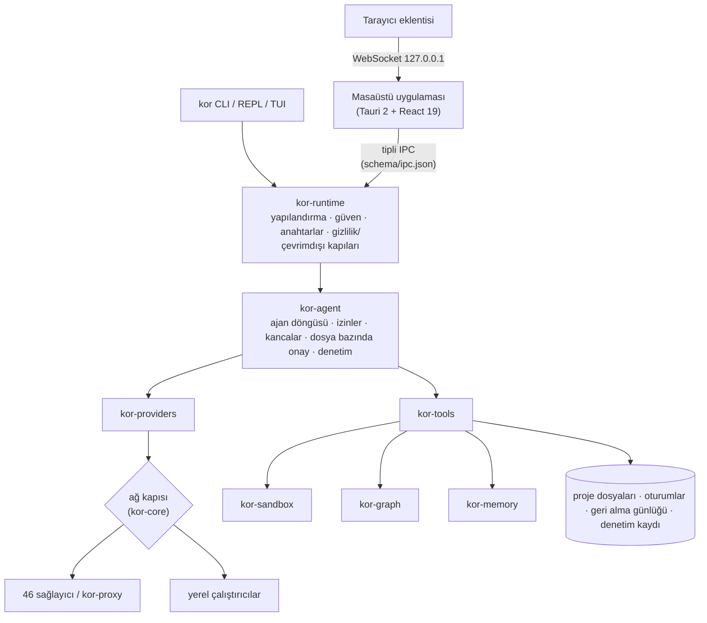

<details>
<summary>Crate haritası</summary>

| Crate | Sorumluluk |
| --- | --- |
| `kor-core` | Ortak tipler, her HTTP istemcisinin kurulduğu ağ kapısı, IPC şeması, ürün sürümü |
| `kor-i18n` | Türkçe, İngilizce ve Fransızca metinler (Fluent, derlemeye gömülü) |
| `kor-platform` | Bütün işletim sistemi farkları tek API arkasında: klasörler, süreçler, kabuk ve OS entegrasyonu, bildirimler, AppContainer, marka |
| `kor-config` | Anahtar başına kaynağı izlenen katmanlı TOML yapılandırması |
| `kor-secrets` | Anahtarlar OS anahtarlığında ya da ortam değişkeninde, asla dosyada; çıktı ve dışa giden içerik maskeleme |
| `kor-sandbox` | bubblewrap, Seatbelt, AppContainer ve Docker sarmalama; ağ izin listesi ve sınırlar |
| `kor-components` | Yardımcı programların ve modellerin Kor'un kendi klasörüne doğrulanmış, kaldığı yerden devam eden indirilmesi |
| `kor-providers` | `Provider` trait'i, protokol adaptörleri (OpenAI uyumlu, Anthropic, Gemini …), bildirimsel manifestolar |
| `kor-proxy` | Yerel OpenAI/Anthropic/Gemini uyumlu ağ geçidi (CLIProxyAPI'nin Rust portu) |
| `kor-tools` | Proje köküyle sınırlı yerleşik araçlar (dosyalar, arama, kabuk, tarayıcı, bilgisayar kontrolü, PDF/OCR) |
| `kor-computer` | Masaüstü kontrol politikası (uygulama başına seviye, kullanıcı girdisinde durma) |
| `kor-graph` | Canlı proje grafı: tree-sitter ayrıştırma, çözümleyici, SQLite deposu, artımlı güncelleme, topluluklar |
| `kor-memory` | Proje hafızası (Markdown) ve genel bilgi tabanı (SQLite, yerel gömmeler) |
| `kor-compat` | Diğer AI kod araçlarının dosyalarını yerinde okur |
| `kor-health` | Sistem profili, sağlık uyarıları, önbellek temizliği |
| `kor-agent` | Ajan döngüsü, oturumlar, alt ajanlar, MCP, denetim kaydı |
| `kor-runtime` | CLI ve masaüstünün paylaştığı oturum kurulumu: güven, anahtarlar, sağlayıcılar, gizlilik/çevrimdışı, güncellemeler |
| `kor-web` | Webmaster modülü: hosting panelleri, WordPress, teknik SEO |
| `kor-cli` | `kor` ikilisi: komutlar, REPL, TUI, `doctor` |

</details>

- **IPC sözleşmesi.** `backend/crates/kor-core/schema/ipc.json` tek kaynaktır; arayüzün tipli istemcisi ondan
  üretilir ve arayüz şemada olmayan bir yöntemi çağırırsa testler kırılır.
- **Eşitlik testleri.** `parity.toml` her CLI komutunu TUI slash komutu ve masaüstü yöntemiyle birlikte listeler. Yeni
  bir komut listelenmezse CLI testi kırılır, arayüz testi her satırın paletten ulaşılabilir olduğunu denetler ve izin
  verilen boşluk sayısı yalnızca azalabilir.
- **Platform kuralı.** İşletim sistemine özgü kod yalnızca `kor-platform` ve `kor-sandbox` içinde yaşar; bir mandal
  testi yayılmasını engeller. (Eskiden kalan az sayıda dal hâlâ taşınıyor.)
- **Depolama** düz dosyalardır: TOML yapılandırma, JSONL oturumlar, Markdown hafıza, graf ve bilgi tabanı için SQLite.

---

## Güncellemeler

- **CLI:** `kor update` GitHub Releases'ı denetler, minisign imzasını doğrular ve ikiliyi atomik olarak değiştirir.
  `kor update check`, `kor update channel stable|beta|nightly`, `kor update rollback`, internetsiz makineler için
  `kor update --from <dosya>`. İmzasız bir ikili asla kurulmaz.
- **Otomatik denetim:** etkileşimli oturumlarda günde en fazla bir kez, arka planda; sonuç bir sonraki açılışta
  bildirilir (`[update] auto`, `channel`). Gizlilik modunda ve CI'da asla.
- **Masaüstü:** aynı denetim Ayarlar'da; Tauri güncelleyici anahtarı hazırsa uygulama indirip yerinde kurar, değilse
  sürüm sayfasını açar. Paket yöneticisiyle yapılan kurulumlarda (winget, Homebrew, apt, Flatpak) yalnızca bildirim yapılır.

İlk imzalı sürüm çıkmadan bunların hiçbiri çalışamaz.

---

## Yol haritası ve durum

**Durum.** `v0.8.0` ilk açık derleme: baştan sona çalışıyor ama erken aşamada bir yazılım. Doğrulananlar:

- CLI/TUI/masaüstü arasında eşit, testlerle korunan yaklaşık 400 komut.
- Ağ kesikken tam bir çevrimdışı görev (otomatik test) ve Windows'ta llama.cpp ile küçük bir Qwen modeliyle gerçek
  bir çevrimdışı tur.
- Windows'ta sandbox'ın yazmayı engellemesi; beş ajanlı görevin çakışmasız birleşmesi; sahte servislerle git push
  tetikleyicisinden PR'a döngü; 110 bin satırlık depoda graf artımlı güncellemesinin 1 saniyenin altında kalması.
- 78 ekranda yaklaşık 4.400 kontrolün (etiket, kontrast, odak halkası, kesilme, taşma, konsol hatası) teftişi:
  **sıfır açık bulgu**. Bulgu geri gelirse sürüm kırmızıya düşer.

Henüz doğrulanmayanlar: sağlayıcıların canlı API'lere karşı testi (her manifestoda `verified = false`), OCR,
erişilebilirlik ve sandbox'ın macOS ve Linux arka uçlarının gerçek makinelerde çalışması, yönlendirici ve graf
tasarruf hedeflerinin gerçek modellerle ölçümü.

### Yapılacaklar

Toplam 98 açık madde: **65 geliştirme işi**, bakımcı için 12 hesap/yayın adımı, 16 gerçek ortam denemesi ve 5 karar.
Geliştirme işleri:

**Faz 8 — takım ve platform (8)**
- [ ] Kor Server: kendi sunucunda takım modu (paylaşılan kurallar, graf ve hafıza, görev kuyruğu, merkezi denetim, Postgres, mTLS)
- [ ] OIDC / SSO (Keycloak, Authentik, Google, GitHub) ve rol tabanlı yetki
- [ ] KaaS API (`POST /api/v1/tasks`, WebSocket, callback) ve Kor'un OpenAI uyumlu bir model ucu olarak sunulması
- [ ] İmzalı eklentiler, izin onayı ve katalogla WASM eklenti çalışma zamanı (`kor plugin search/create`)
- [ ] VS Code, Neovim, Zed ve JetBrains için `kor lsp`
- [ ] Takım kasası, şablon/hook/kural senkronu; takım sunucusu üzerinden peer rölesi; Faz 8 kabul testleri

**Ajan, diller ve hafıza**
- [x] 40'tan fazla dil için tree-sitter (46)
- [x] Grafta doküman/PDF kavram katmanı: `docs/` altındaki Markdown (ve README) başlıkları ile oradaki PDF'ler, adını verdikleri koda bağlı kavram düğümleri olur
- [ ] Sıcak hafıza katmanı ve RAM'de HNSW
- [ ] Yerel küçük modelle fish tarzı satır içi kabuk önerisi
- [ ] Sandbox'ta alan adı bazlı ağ kuralları, Linux/macOS'ta kesin CPU tavanı (bugün: `nice` önceliği)
- [ ] Kayıtlı düzenlerde sanal masaüstü; Windows uzak sunucular

**Sağlayıcılar ve maliyet**
- [ ] Vertex ADC, Azure Entra ID, OCI imzalı kimlik
- [ ] Katalogda LMArena ve LiveBench skorları (ikisinin de veri ucu yok)
- [ ] `kor quota`'da proxy kotası

**Web, medya ve entegrasyonlar**
- [ ] Türk ödeme, kargo, pazaryeri ve alan adı firmaları bağdaştırıcıları; backlink araçları
- [ ] Doğrudan medya sağlayıcıları (OpenAI Images, Imagen/Veo, Stability, Runway, Luma) ve yerel ComfyUI
- [ ] Forge: CI durumundan düzeltme, issue → görev, sürüm notları, Bitbucket Server

**Arayüz**
- [ ] Kalan yan panel görünümlerinin sol çubuğa ve ayarlara dağıtılması
- [ ] Chrome yan panelinde galeri medyası

**Test, sürüm ve kod sağlığı**
- [ ] CLI boyut ve başlangıç bütçeleri (bugün 68,6 MB ve 42 ms); statik musl ve Windows ARM64 derlemeleri
- [ ] CLI yardım/hata snapshot'ları; macOS masaüstü E2E; tekrarlanabilir derleme; PGO
- [ ] İş mantığının masaüstü köprüsünden çekirdeğe taşınması; büyük crate'lerin bölünmesi; `deny(missing_docs)`; kullanıcı ve eklenti rehberleri

Spec referansları ve dosya yollarıyla tam liste bakımcıda tutuluyor; her sürümde burada özetleniyor.

---

## Katkıda bulunma

Katkılar memnuniyetle karşılanır. [CONTRIBUTING.md](CONTRIBUTING.md) ile başla.

```bash
just fmt          # rustfmt
just lint         # clippy -D warnings, TypeScript strict, tasarım denetimleri
just test         # Rust, arayüz ve araç testleri
```

- Mimari değişiklikler (yeni bir crate, crate'ler arası yeni bir bağımlılık, yeni bir depolama biçimi, yeni bir ağ
  hedefi) tasarımı netleştirmek için önce bir konu (issue) açılmasını ister.
- Conventional Commits; Developer Certificate of Origin için her commit imzalı (`git commit -s`).
- Telemetri yok, kullanıcının yapılandırmadığı bir hedefe ağ çağrısı yok, günlüklerde sır yok.
- Yalnızca OSI onaylı bağımlılık lisansları.

Kor para kazanmaz: ücretli
sürüm, lisans anahtarı ya da zorunlu hesap yok.

## Çeviriler (i18n)

Arayüz **Türkçe, İngilizce ve Fransızca** olarak kullanılabilir; kullanıcıya görünen her metin üç dilde de bulunmalıdır.

- CLI ve TUI: `backend/crates/kor-i18n/locales/{en,tr,fr}/kor.ftl` (Fluent). Eksik bir anahtar
  `every_locale_has_the_same_keys` testini kırar. Fransızcada `: ; ? !` öncesinde dar bölünmez boşluk kullanılır.
- Masaüstü: Türkçe kaynak metinler, İngilizce ve Fransızca kataloglar `frontend/src/desktop/renderer/i18n/`
  (`en.json`, `fr.json`) altında.

Yeni bir dil, yeni bir `.ftl` klasörü ve bir arayüz kataloğu demektir; dil kodunda anlaşmak için önce bir issue aç.

## Topluluk

- Sorular, fikirler ve hata bildirimleri: [GitHub Issues](https://github.com/LLCForge/Kor/issues). `good first issue`
  ve `help wanted` etiketli konular iyi bir başlangıç noktasıdır.
- Güvenlik sorunları: [SECURITY.md](SECURITY.md) üzerinden, gizli olarak.
- Herkesin [Davranış Kuralları](CODE_OF_CONDUCT.md)'na uyması beklenir.
- Değişiklikler [backend/CHANGELOG.md](backend/CHANGELOG.md) dosyasında kayıtlıdır.

## Lisans

Kor, tercihine göre [Apache-2.0](LICENSE-APACHE) ya da [MIT](LICENSE-MIT) lisansıyla çift lisanslıdır. `assets/`
altındaki marka varlıkları CC-BY-4.0'dır; üçüncü taraf varlık lisansları [assets/LICENSES.toml](assets/LICENSES.toml)
dosyasında listelenir. Bakımını LLCForge ve katkıda bulunanlar yapar.

## Teşekkürler

- Kor'un varsayılan modeline güç veren gizli ve sansürsüz çıkarım için **[Venice.ai](https://venice.ai)**.
- Model seçicide ve karşılaştırma görünümünde gösterilen zekâ ve kodlama indeksleri için
  **[Artificial Analysis](https://artificialanalysis.ai)** (atıf katalogda ve `kor catalog` çıktısında yer alır).
- Kataloğun dayandığı herkese açık model bilgileri için **[OpenRouter](https://openrouter.ai)** ve
  **[Hugging Face](https://huggingface.co)**.
- `kor-proxy`'nin Rust'a taşıdığı **[CLIProxyAPI](https://github.com/router-for-me/CLIProxyAPI)**.
- Yerleşik becerilerin yazarları: [Addy Osmani](https://github.com/addyosmani/agent-skills) (MIT),
  [blader](https://github.com/blader/humanizer) (MIT), [Nate Herk](https://github.com/nateherkai/scroll-craft) (MIT),
  [HeyGen](https://github.com/heygen-com/hyperframes) (Apache-2.0) ve [Sindre Sorhus](https://github.com/sindresorhus/awesome) (CC0).
- Kor'un üzerine kurulduğu açık kaynak projeler; aralarında [Tauri](https://tauri.app), [tree-sitter](https://tree-sitter.github.io),
  [llama.cpp](https://github.com/ggml-org/llama.cpp), [whisper.cpp](https://github.com/ggml-org/whisper.cpp),
  [candle](https://github.com/huggingface/candle), [ratatui](https://ratatui.rs), [Tokio](https://tokio.rs),
  [clap](https://github.com/clap-rs/clap), [rusqlite](https://github.com/rusqlite/rusqlite),
  [petgraph](https://github.com/petgraph/petgraph), [snow](https://github.com/mcginty/snow) (Noise protokolü),
  [Fluent](https://projectfluent.org), [PDFium](https://pdfium.googlesource.com/pdfium/), [enigo](https://github.com/enigo-rs/enigo),
  [xcap](https://github.com/nashaofu/xcap), [React](https://react.dev) ve [Figtree](https://github.com/erikdkennedy/figtree)
  yazı tipi (OFL) var.
